# component-readme

这些动画由 SVG / CSS 代码画框模拟，用于快速理解布局和信息出现顺序。它们不是组件截图，也不是精确复刻：颜色、数值、时长均为示意。每轮约 4.8 秒。静态基础组件的示意包含外层入场或参数切换，组件自身没有自动动画。

覆盖：109 个原场景组件、25 种 scene.type（24 种节目模板 + legacy 适配）、25 个可复用基础 / 绘图 / 编排组件，共 159 项。辅助函数、类型、Studio / Root / Reel 入口不作为视觉组件重复计数。

**查看方式**：直接用浏览器打开同目录的 `component-readme.html`，支持搜索、分类、暂停和重播。Markdown 中每项也引用一份独立的动画 SVG；部分 Markdown 阅读器会禁用 SVG 动画，此时使用 HTML。将本目录文件复制到项目根目录，源码相对链接即可跳转。

**直接使用原组件**：运行 `pnpm dev`，在 Remotion Studio 中选择条目写出的 Composition ID；修改组件 props 或源码。

**使用节目模板**：把模板示例放入 Episode 的 `scenes`；示例取自 `examples/template-gallery.json`，请同时保留示例文件对应的 `sources`、素材和 episode 配置。用 `FinanceEpisode` 渲染，或运行 `pnpm workbench` 编辑节目 JSON。scene JSON 是镜头数据，不是新的 React 组件导出。

**改自己的样式**：原组件从 `src/style/theme.ts`、`src/style/index.css` 和 `src/style/fonts.ts` 管理；节目模板从 `src/brand/presets.ts` 和 Episode 的 `brand.overrides` 管理；本说明的框图配色和节奏在 `scripts/generate-component-readme.py` 的颜色常量、`CSS` 和 `geometry()` 中管理。生成说明不会修改原组件或字体。

## 分类目录

### 原场景组件 · 109

- **分类比较**：[BarChart](#chart-bar) · [BulletChart](#chart-bullet) · [DivergingBarChart](#chart-divergingbar) · [DotPlot](#chart-dotplot) · [GroupedBarChart](#chart-groupedbar) · [LollipopChart](#chart-lollipop) · [PairedBarChart](#chart-pairedbar) · [ParetoChart](#chart-pareto) · [RankingChart](#chart-ranking) · [ScenarioBarChart](#chart-scenariobar) · [TornadoChart](#chart-tornado) · [VarianceComparisonChart](#chart-variancecomparison)

- **跨组比较**：[BenchmarkBandChart](#chart-benchmarkband) · [DumbbellChart](#chart-dumbbell) · [SlopeChart](#chart-slope) · [SmallMultiples](#chart-smallmultiples)

- **结构占比**：[CompositionCompareChart](#chart-compositioncompare) · [ContributionBarChart](#chart-contributionbar) · [DistributionBlocksChart](#chart-distributionblocks) · [DonutChart](#chart-donut) · [MarimekkoChart](#chart-marimekko) · [NestedCompositionChart](#chart-nestedcomposition) · [PictogramChart](#chart-pictogram) · [StackedBarChart](#chart-stackedbar) · [TreemapChart](#chart-treemap) · [WaffleChart](#chart-waffle) · [WaterfallChart](#chart-waterfall)

- **分布与密度**：[BeeswarmPlot](#chart-beeswarm) · [BoxPlot](#chart-boxplot) · [BubbleChart](#chart-bubble) · [CalendarHeatmap](#chart-calendarheatmap) · [CohortMatrix](#chart-cohortmatrix) · [DotStripPlot](#chart-dotstrip) · [Heatmap](#chart-heatmap) · [Histogram](#chart-histogram) · [PopulationPyramid](#chart-populationpyramid) · [RidgelinePlot](#chart-ridgeline) · [ScatterPlot](#chart-scatter)

- **多维比较**：[ParallelCoordinates](#chart-parallelcoordinates) · [QuadrantScatterChart](#chart-quadrantscatter) · [RadarChart](#chart-radar)

- **时间序列**：[AnnotatedLineChart](#chart-annotatedline) · [AreaChart](#chart-area) · [BumpChart](#chart-bump) · [CandlestickChart](#chart-candlestick) · [ConnectedScatterPlot](#chart-connectedscatter) · [DualAxisChart](#chart-dualaxis) · [EventStudyChart](#chart-eventstudy) · [IndexedComparisonChart](#chart-indexedcomparison) · [IndexedLineChart](#chart-indexedline) · [LineChart](#chart-line) · [MultiLineChart](#chart-multiline) · [StackedAreaChart](#chart-stackedarea)

- **区间与预测**：[ForecastFanChart](#chart-forecastfan) · [RangeBandChart](#chart-rangeband)

- **财务结构**：[BalanceSheetDiagram](#diagram-balancesheet) · [CapitalStackDiagram](#diagram-capitalstack)

- **流程与价值链**：[FlowDiagram](#diagram-flow) · [FunnelDiagram](#diagram-funnel) · [SankeyDiagram](#diagram-sankey) · [TwoSidedMarketplaceDiagram](#diagram-twosidedmarketplace) · [UnitEconomicsDiagram](#diagram-uniteconomics) · [ValueChainDiagram](#diagram-valuechain) · [ValueChainMap](#diagram-valuechainmap)

- **层级结构**：[HierarchyPyramid](#diagram-hierarchypyramid) · [OrganizationTree](#diagram-organizationtree) · [OwnershipTree](#diagram-ownershiptree)

- **关系网络**：[CapabilityVennDiagram](#diagram-capabilityvenn) · [CausalGraph](#diagram-causalgraph) · [CompetitiveLandscapeDiagram](#diagram-competitivelandscape) · [EcosystemMap](#diagram-ecosystemmap) · [RelationshipGraph](#diagram-relationshipgraph) · [RivalryNetworkDiagram](#diagram-rivalrynetwork)

- **规划与拆解**：[BridgeToTarget](#framework-bridgetotarget) · [IssueTree](#framework-issuetree) · [MetricDriverTree](#framework-metricdrivertree) · [ScenarioTree](#framework-scenariotree) · [StrategicRoadmap](#framework-strategicroadmap)

- **过程与职责**：[SwimlaneDiagram](#framework-swimlane)

- **战略矩阵**：[OpportunityMatrix](#framework-opportunitymatrix) · [PrioritizationMatrix](#framework-prioritizationmatrix) · [RiskMatrix](#framework-riskmatrix) · [StrategyMatrix](#framework-strategymatrix)

- **媒体素材**：[ImageCard](#media-imagecard) · [LogoCloud](#media-logocloud) · [MapCallout](#media-mapcallout) · [QuoteCard](#media-quote) · [ScreenshotZoom](#media-screenshotzoom)

- **核心指标**：[FactGrid](#metric-factgrid) · [HeroMetric](#metric-herometric) · [MetricGrid](#metric-grid) · [ShareMetric](#metric-share) · [SplitMetric](#metric-split)

- **叙事说明**：[BeforeAfterCompare](#narrative-beforeafter) · [BulletReveal](#narrative-bulletreveal) · [CompareCards](#narrative-comparecards) · [EquationCards](#narrative-equation) · [ExecutiveSummary](#narrative-executivesummary) · [KeyTakeaway](#narrative-keytakeaway) · [PageFlipChoice](#narrative-pageflipchoice) · [SideBySideCompare](#narrative-sidebysidecompare) · [Timeline](#narrative-timeline)

- **画面叠加**：[PresenterOrbitOverlay](#overlay-presenterorbit) · [TickerOverlay](#overlay-ticker)

- **数据表格**：[BenchmarkScorecard](#table-benchmarkscorecard) · [CapabilityHeatmap](#table-capabilityheatmap) · [DistributionComparisonTable](#table-distributioncomparison) · [MetricTable](#table-metric) · [SparklineTable](#table-sparkline)

### 节目模板 · 25

- **节目包装**：[节目片头](#template-opener) · [章节转场](#template-chapter) · [焦点头条](#template-headline) · [新闻简报](#template-news-grid) · [来源索引](#template-sources) · [节目片尾](#template-endcard)

- **数据图表**：[核心数字](#template-hero) · [指标看板](#template-kpis) · [条形 / 柱状图](#template-bars) · [排名榜单](#template-ranking) · [趋势与预测](#template-trend) · [利润瀑布](#template-waterfall) · [结构占比](#template-donut) · [财务数据表](#template-table)

- **公司研究**：[财报快照](#template-earnings) · [三情景分析](#template-scenario)

- **观点叙事**：[双边对照](#template-comparison) · [人物引述](#template-quote) · [事件时间线](#template-timeline) · [公式拆解](#template-equation) · [逐条解释](#template-bullets) · [核心结论](#template-takeaway)

- **媒体素材**：[图像与证据](#template-media) · [主持人分屏](#template-presenter)

- **扩展组件**：[原组件适配](#template-legacy)

### 基础、绘图与编排组件 · 25

- **基础与绘图**：[Frame](#base-frame) · [BrutalCard](#base-brutalcard) · [SceneHeader](#base-sceneheader) · [Source](#base-source) · [Tag](#base-tag) · [GridLines](#base-gridlines) · [MiniLegend](#base-minilegend) · [OverlayShell](#base-overlayshell) · [InlineLegend](#base-inlinelegend) · [StructuralDiagram](#base-structuraldiagram) · [TreeEdge](#base-treeedge) · [NodeCard](#base-nodecard) · [EdgeLabel](#base-edgelabel) · [Panel](#base-panel) · [Reveal](#base-reveal) · [Delta](#base-delta) · [MetricValue](#base-metricvalue) · [SceneFrame](#base-sceneframe) · [Bars](#base-bars) · [Trend](#base-trend) · [Waterfall](#base-waterfall) · [Donut](#base-donut)

- **上下文与编排**：[BrandProvider](#base-brandprovider) · [FinanceEpisode](#base-financeepisode) · [SceneContent](#base-scenecontent)

## 原场景组件

<a id="chart-bar"></a>

### BarChart

**用途**：比较不同类别的规模。


**示意顺序**：1. 坐标框出现 → 2. 柱子由零长高 → 3. 数值标签显示。

**源码**：[src/scenes/charts/categorical/BarChart.tsx](src/scenes/charts/categorical/BarChart.tsx)

**Composition ID**：`Chart-Bar`

**参数**：`data`、`title`、`eyebrow`、`unit`、`source`。

```tsx
import { BarChart } from "./src/scenes/charts/categorical/BarChart";

<BarChart {...props} />
```

`props` 的字段、结构和内置样例见本条源码及 `schemas/legacy-catalog.json`；可从 Studio 默认示例开始修改。

<a id="chart-bullet"></a>

### BulletChart

**用途**：比较实际表现与目标。


**示意顺序**：1. 背景区间出现 → 2. 实际条伸长 → 3. 目标刻线显示。

**源码**：[src/scenes/charts/categorical/BulletChart.tsx](src/scenes/charts/categorical/BulletChart.tsx)

**Composition ID**：`Chart-Bullet`

**参数**：`eyebrow`、`title`、`rows`。

```tsx
import { BulletChart } from "./src/scenes/charts/categorical/BulletChart";

<BulletChart {...props} />
```

`props` 的字段、结构和内置样例见本条源码及 `schemas/legacy-catalog.json`；可从 Studio 默认示例开始修改。

<a id="chart-divergingbar"></a>

### DivergingBarChart

**用途**：比较正负两侧的变化。


**示意顺序**：1. 中轴出现 → 2. 条形向左右展开 → 3. 正负值显示。

**源码**：[src/scenes/charts/categorical/DivergingBarChart.tsx](src/scenes/charts/categorical/DivergingBarChart.tsx)

**Composition ID**：`Chart-DivergingBar`

**参数**：`eyebrow`、`title`、`items`、`suffix`。

```tsx
import { DivergingBarChart } from "./src/scenes/charts/categorical/DivergingBarChart";

<DivergingBarChart {...props} />
```

`props` 的字段、结构和内置样例见本条源码及 `schemas/legacy-catalog.json`；可从 Studio 默认示例开始修改。

<a id="chart-dotplot"></a>

### DotPlot

**用途**：用同一坐标轴比较数值。


**示意顺序**：1. 类别行出现 → 2. 数据点依次显现 → 3. 读数显示。

**源码**：[src/scenes/charts/categorical/DotPlot.tsx](src/scenes/charts/categorical/DotPlot.tsx)

**Composition ID**：`Chart-DotPlot`

**参数**：`eyebrow`、`title`、`items`、`suffix`。

```tsx
import { DotPlot } from "./src/scenes/charts/categorical/DotPlot";

<DotPlot {...props} />
```

`props` 的字段、结构和内置样例见本条源码及 `schemas/legacy-catalog.json`；可从 Studio 默认示例开始修改。

<a id="chart-groupedbar"></a>

### GroupedBarChart

**用途**：比较各类别中的多组指标。


**示意顺序**：1. 类别框出现 → 2. 同组双柱长高 → 3. 图例补齐。

**源码**：[src/scenes/charts/categorical/GroupedBarChart.tsx](src/scenes/charts/categorical/GroupedBarChart.tsx)

**Composition ID**：`Chart-GroupedBar`

**参数**：`eyebrow`、`title`、`data`、`labels`、`source`。

```tsx
import { GroupedBarChart } from "./src/scenes/charts/categorical/GroupedBarChart";

<GroupedBarChart {...props} />
```

`props` 的字段、结构和内置样例见本条源码及 `schemas/legacy-catalog.json`；可从 Studio 默认示例开始修改。

<a id="chart-lollipop"></a>

### LollipopChart

**用途**：用细杆和圆点比较规模。


**示意顺序**：1. 坐标框出现 → 2. 细杆伸长 → 3. 端点与标签出现。

**源码**：[src/scenes/charts/categorical/LollipopChart.tsx](src/scenes/charts/categorical/LollipopChart.tsx)

**Composition ID**：`Chart-Lollipop`

**参数**：`eyebrow`、`title`、`items`、`suffix`。

```tsx
import { LollipopChart } from "./src/scenes/charts/categorical/LollipopChart";

<LollipopChart {...props} />
```

`props` 的字段、结构和内置样例见本条源码及 `schemas/legacy-catalog.json`；可从 Studio 默认示例开始修改。

<a id="chart-pairedbar"></a>

### PairedBarChart

**用途**：逐项比较两组并列数据。


**示意顺序**：1. 类别行出现 → 2. 两条分别展开 → 3. 差值可读。

**源码**：[src/scenes/charts/categorical/PairedBarChart.tsx](src/scenes/charts/categorical/PairedBarChart.tsx)

**Composition ID**：`Chart-PairedBar`

**参数**：`eyebrow`、`title`、`data`、`aLabel`、`bLabel`、`suffix`、`source`。

```tsx
import { PairedBarChart } from "./src/scenes/charts/categorical/PairedBarChart";

<PairedBarChart {...props} />
```

`props` 的字段、结构和内置样例见本条源码及 `schemas/legacy-catalog.json`；可从 Studio 默认示例开始修改。

<a id="chart-pareto"></a>

### ParetoChart

**用途**：识别主要贡献项及累计贡献。


**示意顺序**：1. 降序柱出现 → 2. 累计线绘出 → 3. 累计比例显示。

**源码**：[src/scenes/charts/categorical/ParetoChart.tsx](src/scenes/charts/categorical/ParetoChart.tsx)

**Composition ID**：`Chart-Pareto`

**参数**：`eyebrow`、`title`、`items`。

```tsx
import { ParetoChart } from "./src/scenes/charts/categorical/ParetoChart";

<ParetoChart {...props} />
```

`props` 的字段、结构和内置样例见本条源码及 `schemas/legacy-catalog.json`；可从 Studio 默认示例开始修改。

<a id="chart-ranking"></a>

### RankingChart

**用途**：呈现有序排名和差距。


**示意顺序**：1. 排名行出现 → 2. 横条依次伸长 → 3. 名次与值显示。

**源码**：[src/scenes/charts/categorical/RankingChart.tsx](src/scenes/charts/categorical/RankingChart.tsx)

**Composition ID**：`Chart-Ranking`

**参数**：`data`。

```tsx
import { RankingChart } from "./src/scenes/charts/categorical/RankingChart";

<RankingChart {...props} />
```

`props` 的字段、结构和内置样例见本条源码及 `schemas/legacy-catalog.json`；可从 Studio 默认示例开始修改。

<a id="chart-scenariobar"></a>

### ScenarioBarChart

**用途**：比较悲观、基准和乐观情景。


**示意顺序**：1. 三个情景框出现 → 2. 情景柱长高 → 3. 假设标签显示。

**源码**：[src/scenes/charts/categorical/ScenarioBarChart.tsx](src/scenes/charts/categorical/ScenarioBarChart.tsx)

**Composition ID**：`Chart-ScenarioBar`

**参数**：`eyebrow`、`title`、`scenarios`、`prefix`。

```tsx
import { ScenarioBarChart } from "./src/scenes/charts/categorical/ScenarioBarChart";

<ScenarioBarChart {...props} />
```

`props` 的字段、结构和内置样例见本条源码及 `schemas/legacy-catalog.json`；可从 Studio 默认示例开始修改。

<a id="chart-tornado"></a>

### TornadoChart

**用途**：按影响大小比较敏感性。


**示意顺序**：1. 中心轴出现 → 2. 双侧影响条展开 → 3. 变量标签显示。

**源码**：[src/scenes/charts/categorical/TornadoChart.tsx](src/scenes/charts/categorical/TornadoChart.tsx)

**Composition ID**：`Chart-Tornado`

**参数**：`eyebrow`、`title`、`rows`、`suffix`。

```tsx
import { TornadoChart } from "./src/scenes/charts/categorical/TornadoChart";

<TornadoChart {...props} />
```

`props` 的字段、结构和内置样例见本条源码及 `schemas/legacy-catalog.json`；可从 Studio 默认示例开始修改。

<a id="chart-variancecomparison"></a>

### VarianceComparisonChart

**用途**：比较计划、实际及偏差。


**示意顺序**：1. 计划框出现 → 2. 实际条展开 → 3. 偏差标签显示。

**源码**：[src/scenes/charts/categorical/VarianceComparisonChart.tsx](src/scenes/charts/categorical/VarianceComparisonChart.tsx)

**Composition ID**：`Chart-VarianceComparison`

**参数**：`eyebrow`、`title`、`data`、`actualLabel`、`benchmarkLabel`。

```tsx
import { VarianceComparisonChart } from "./src/scenes/charts/categorical/VarianceComparisonChart";

<VarianceComparisonChart {...props} />
```

`props` 的字段、结构和内置样例见本条源码及 `schemas/legacy-catalog.json`；可从 Studio 默认示例开始修改。

<a id="chart-benchmarkband"></a>

### BenchmarkBandChart

**用途**：把指标放进基准区间比较。


**示意顺序**：1. 基准带出现 → 2. 实际走势绘出 → 3. 区间关系可读。

**源码**：[src/scenes/charts/comparison/BenchmarkBandChart.tsx](src/scenes/charts/comparison/BenchmarkBandChart.tsx)

**Composition ID**：`Chart-BenchmarkBand`

**参数**：`eyebrow`、`title`、`data`。

```tsx
import { BenchmarkBandChart } from "./src/scenes/charts/comparison/BenchmarkBandChart";

<BenchmarkBandChart {...props} />
```

`props` 的字段、结构和内置样例见本条源码及 `schemas/legacy-catalog.json`；可从 Studio 默认示例开始修改。

<a id="chart-dumbbell"></a>

### DumbbellChart

**用途**：比较每项的两个端点。


**示意顺序**：1. 类别行出现 → 2. 端点显示 → 3. 连接杆展开。

**源码**：[src/scenes/charts/comparison/DumbbellChart.tsx](src/scenes/charts/comparison/DumbbellChart.tsx)

**Composition ID**：`Chart-Dumbbell`

**参数**：`eyebrow`、`title`、`data`、`fromLabel`、`toLabel`、`suffix`、`source`。

```tsx
import { DumbbellChart } from "./src/scenes/charts/comparison/DumbbellChart";

<DumbbellChart {...props} />
```

`props` 的字段、结构和内置样例见本条源码及 `schemas/legacy-catalog.json`；可从 Studio 默认示例开始修改。

<a id="chart-slope"></a>

### SlopeChart

**用途**：比较两个时期的相对位置。


**示意顺序**：1. 左右时点出现 → 2. 连接线绘出 → 3. 终点标签显示。

**源码**：[src/scenes/charts/comparison/SlopeChart.tsx](src/scenes/charts/comparison/SlopeChart.tsx)

**Composition ID**：`Chart-Slope`

**参数**：`eyebrow`、`title`、`data`、`startLabel`、`endLabel`、`suffix`、`source`。

```tsx
import { SlopeChart } from "./src/scenes/charts/comparison/SlopeChart";

<SlopeChart {...props} />
```

`props` 的字段、结构和内置样例见本条源码及 `schemas/legacy-catalog.json`；可从 Studio 默认示例开始修改。

<a id="chart-smallmultiples"></a>

### SmallMultiples

**用途**：用统一尺度比较多张小图。


**示意顺序**：1. 小图框依次出现 → 2. 各自走势绘出 → 3. 共同尺度显示。

**源码**：[src/scenes/charts/comparison/SmallMultiples.tsx](src/scenes/charts/comparison/SmallMultiples.tsx)

**Composition ID**：`Chart-SmallMultiples`

**参数**：`eyebrow`、`title`、`panels`。

```tsx
import { SmallMultiples } from "./src/scenes/charts/comparison/SmallMultiples";

<SmallMultiples {...props} />
```

`props` 的字段、结构和内置样例见本条源码及 `schemas/legacy-catalog.json`；可从 Studio 默认示例开始修改。

<a id="chart-compositioncompare"></a>

### CompositionCompareChart

**用途**：比较两组结构占比。


**示意顺序**：1. 两组总量框出现 → 2. 占比区块展开 → 3. 结构标签显示。

**源码**：[src/scenes/charts/composition/CompositionCompareChart.tsx](src/scenes/charts/composition/CompositionCompareChart.tsx)

**Composition ID**：`Chart-CompositionCompare`

**参数**：`eyebrow`、`title`、`rows`。

```tsx
import { CompositionCompareChart } from "./src/scenes/charts/composition/CompositionCompareChart";

<CompositionCompareChart {...props} />
```

`props` 的字段、结构和内置样例见本条源码及 `schemas/legacy-catalog.json`；可从 Studio 默认示例开始修改。

<a id="chart-contributionbar"></a>

### ContributionBarChart

**用途**：拆解对总量的贡献。


**示意顺序**：1. 贡献行出现 → 2. 分项条展开 → 3. 总量框显示。

**源码**：[src/scenes/charts/composition/ContributionBarChart.tsx](src/scenes/charts/composition/ContributionBarChart.tsx)

**Composition ID**：`Chart-ContributionBar`

**参数**：`eyebrow`、`title`、`items`、`suffix`。

```tsx
import { ContributionBarChart } from "./src/scenes/charts/composition/ContributionBarChart";

<ContributionBarChart {...props} />
```

`props` 的字段、结构和内置样例见本条源码及 `schemas/legacy-catalog.json`；可从 Studio 默认示例开始修改。

<a id="chart-distributionblocks"></a>

### DistributionBlocksChart

**用途**：用区块呈现分配结构。


**示意顺序**：1. 总量框出现 → 2. 分配块依次填充 → 3. 比例标签显示。

**源码**：[src/scenes/charts/composition/DistributionBlocksChart.tsx](src/scenes/charts/composition/DistributionBlocksChart.tsx)

**Composition ID**：`Chart-DistributionBlocks`

**参数**：`eyebrow`、`title`、`groups`、`unit`、`source`。

```tsx
import { DistributionBlocksChart } from "./src/scenes/charts/composition/DistributionBlocksChart";

<DistributionBlocksChart {...props} />
```

`props` 的字段、结构和内置样例见本条源码及 `schemas/legacy-catalog.json`；可从 Studio 默认示例开始修改。

<a id="chart-donut"></a>

### DonutChart

**用途**：展示整体中的各部分占比。


**示意顺序**：1. 环形底框出现 → 2. 分段依次描出 → 3. 中心总量显示。

**源码**：[src/scenes/charts/composition/DonutChart.tsx](src/scenes/charts/composition/DonutChart.tsx)

**Composition ID**：`Chart-Donut`

**参数**：`value`。

```tsx
import { DonutChart } from "./src/scenes/charts/composition/DonutChart";

<DonutChart {...props} />
```

`props` 的字段、结构和内置样例见本条源码及 `schemas/legacy-catalog.json`；可从 Studio 默认示例开始修改。

<a id="chart-marimekko"></a>

### MarimekkoChart

**用途**：同时比较类别规模与内部结构。


**示意顺序**：1. 总框出现 → 2. 不同宽度的列展开 → 3. 列内分段显现。

**源码**：[src/scenes/charts/composition/MarimekkoChart.tsx](src/scenes/charts/composition/MarimekkoChart.tsx)

**Composition ID**：`Chart-Marimekko`

**参数**：`eyebrow`、`title`、`markets`。

```tsx
import { MarimekkoChart } from "./src/scenes/charts/composition/MarimekkoChart";

<MarimekkoChart {...props} />
```

`props` 的字段、结构和内置样例见本条源码及 `schemas/legacy-catalog.json`；可从 Studio 默认示例开始修改。

<a id="chart-nestedcomposition"></a>

### NestedCompositionChart

**用途**：展示整体、子项和孙项。


**示意顺序**：1. 外层整体框出现 → 2. 子框出现 → 3. 内部细分显示。

**源码**：[src/scenes/charts/composition/NestedCompositionChart.tsx](src/scenes/charts/composition/NestedCompositionChart.tsx)

**Composition ID**：`Chart-NestedComposition`

**参数**：`eyebrow`、`title`、`groups`。

```tsx
import { NestedCompositionChart } from "./src/scenes/charts/composition/NestedCompositionChart";

<NestedCompositionChart {...props} />
```

`props` 的字段、结构和内置样例见本条源码及 `schemas/legacy-catalog.json`；可从 Studio 默认示例开始修改。

<a id="chart-pictogram"></a>

### PictogramChart

**用途**：用图标单元表现比例。


**示意顺序**：1. 图标阵列出现 → 2. 部分单元依次强调 → 3. 份额标签显示。

**源码**：[src/scenes/charts/composition/PictogramChart.tsx](src/scenes/charts/composition/PictogramChart.tsx)

**Composition ID**：`Chart-Pictogram`

**参数**：`total`、`highlighted`、`icon`。

```tsx
import { PictogramChart } from "./src/scenes/charts/composition/PictogramChart";

<PictogramChart {...props} />
```

`props` 的字段、结构和内置样例见本条源码及 `schemas/legacy-catalog.json`；可从 Studio 默认示例开始修改。

<a id="chart-stackedbar"></a>

### StackedBarChart

**用途**：比较多个类别的构成。


**示意顺序**：1. 各类别底座出现 → 2. 分段累计长高 → 3. 图例显示。

**源码**：[src/scenes/charts/composition/StackedBarChart.tsx](src/scenes/charts/composition/StackedBarChart.tsx)

**Composition ID**：`Chart-StackedBar`

**参数**：`segments`、`title`、`eyebrow`。

```tsx
import { StackedBarChart } from "./src/scenes/charts/composition/StackedBarChart";

<StackedBarChart {...props} />
```

`props` 的字段、结构和内置样例见本条源码及 `schemas/legacy-catalog.json`；可从 Studio 默认示例开始修改。

<a id="chart-treemap"></a>

### TreemapChart

**用途**：用嵌套面积表示结构。


**示意顺序**：1. 总面积框出现 → 2. 一级区块展开 → 3. 子区块显示。

**源码**：[src/scenes/charts/composition/TreemapChart.tsx](src/scenes/charts/composition/TreemapChart.tsx)

**Composition ID**：`Chart-Treemap`

**参数**：`eyebrow`、`title`、`items`。

```tsx
import { TreemapChart } from "./src/scenes/charts/composition/TreemapChart";

<TreemapChart {...props} />
```

`props` 的字段、结构和内置样例见本条源码及 `schemas/legacy-catalog.json`；可从 Studio 默认示例开始修改。

<a id="chart-waffle"></a>

### WaffleChart

**用途**：用等大方格表示份额。


**示意顺序**：1. 方格底图出现 → 2. 份额单元依次填色 → 3. 比例显示。

**源码**：[src/scenes/charts/composition/WaffleChart.tsx](src/scenes/charts/composition/WaffleChart.tsx)

**Composition ID**：`Chart-Waffle`

**参数**：`value`、`label`。

```tsx
import { WaffleChart } from "./src/scenes/charts/composition/WaffleChart";

<WaffleChart {...props} />
```

`props` 的字段、结构和内置样例见本条源码及 `schemas/legacy-catalog.json`；可从 Studio 默认示例开始修改。

<a id="chart-waterfall"></a>

### WaterfallChart

**用途**：从起点逐项桥接到终点。


**示意顺序**：1. 起点柱出现 → 2. 增减桥接条依次出现 → 3. 终点总量显示。

**源码**：[src/scenes/charts/composition/WaterfallChart.tsx](src/scenes/charts/composition/WaterfallChart.tsx)

**Composition ID**：`Chart-Waterfall`

**参数**：`data`、`title`、`eyebrow`、`unit`、`source`。

```tsx
import { WaterfallChart } from "./src/scenes/charts/composition/WaterfallChart";

<WaterfallChart {...props} />
```

`props` 的字段、结构和内置样例见本条源码及 `schemas/legacy-catalog.json`；可从 Studio 默认示例开始修改。

<a id="chart-beeswarm"></a>

### BeeswarmPlot

**用途**：展示分布密度和聚集。


**示意顺序**：1. 分布轴出现 → 2. 错位点群出现 → 3. 聚集位置可读。

**源码**：[src/scenes/charts/distribution/BeeswarmPlot.tsx](src/scenes/charts/distribution/BeeswarmPlot.tsx)

**Composition ID**：`Chart-Beeswarm`

**参数**：`values`、`title`、`eyebrow`。

```tsx
import { BeeswarmPlot } from "./src/scenes/charts/distribution/BeeswarmPlot";

<BeeswarmPlot {...props} />
```

`props` 的字段、结构和内置样例见本条源码及 `schemas/legacy-catalog.json`；可从 Studio 默认示例开始修改。

<a id="chart-boxplot"></a>

### BoxPlot

**用途**：展示中位数、四分位和离群值。


**示意顺序**：1. 数轴出现 → 2. 箱体与须线展开 → 3. 中位数和离群点显示。

**源码**：[src/scenes/charts/distribution/BoxPlot.tsx](src/scenes/charts/distribution/BoxPlot.tsx)

**Composition ID**：`Chart-BoxPlot`

**参数**：`eyebrow`、`title`、`boxes`。

```tsx
import { BoxPlot } from "./src/scenes/charts/distribution/BoxPlot";

<BoxPlot {...props} />
```

`props` 的字段、结构和内置样例见本条源码及 `schemas/legacy-catalog.json`；可从 Studio 默认示例开始修改。

<a id="chart-bubble"></a>

### BubbleChart

**用途**：用位置和气泡大小展示三维指标。


**示意顺序**：1. 坐标框出现 → 2. 气泡依次放大 → 3. 标签显示。

**源码**：[src/scenes/charts/distribution/BubbleChart.tsx](src/scenes/charts/distribution/BubbleChart.tsx)

**Composition ID**：`Chart-Bubble`

**参数**：`eyebrow`、`title`、`items`、`xLabel`、`yLabel`。

```tsx
import { BubbleChart } from "./src/scenes/charts/distribution/BubbleChart";

<BubbleChart {...props} />
```

`props` 的字段、结构和内置样例见本条源码及 `schemas/legacy-catalog.json`；可从 Studio 默认示例开始修改。

<a id="chart-calendarheatmap"></a>

### CalendarHeatmap

**用途**：按日历位置查看活动强度。


**示意顺序**：1. 周列与日期格出现 → 2. 日期格分批着色 → 3. 强度图例显示。

**源码**：[src/scenes/charts/distribution/CalendarHeatmap.tsx](src/scenes/charts/distribution/CalendarHeatmap.tsx)

**Composition ID**：`Chart-CalendarHeatmap`

**参数**：`values`、`title`、`eyebrow`。

```tsx
import { CalendarHeatmap } from "./src/scenes/charts/distribution/CalendarHeatmap";

<CalendarHeatmap {...props} />
```

`props` 的字段、结构和内置样例见本条源码及 `schemas/legacy-catalog.json`；可从 Studio 默认示例开始修改。

<a id="chart-cohortmatrix"></a>

### CohortMatrix

**用途**：比较各批次的留存或迁移。


**示意顺序**：1. 批次与期间出现 → 2. 三角矩阵展开 → 3. 深浅数值显示。

**源码**：[src/scenes/charts/distribution/CohortMatrix.tsx](src/scenes/charts/distribution/CohortMatrix.tsx)

**Composition ID**：`Chart-CohortMatrix`

**参数**：`eyebrow`、`title`、`cohorts`、`ages`、`values`。

```tsx
import { CohortMatrix } from "./src/scenes/charts/distribution/CohortMatrix";

<CohortMatrix {...props} />
```

`props` 的字段、结构和内置样例见本条源码及 `schemas/legacy-catalog.json`；可从 Studio 默认示例开始修改。

<a id="chart-dotstrip"></a>

### DotStripPlot

**用途**：用条带点阵展示密度。


**示意顺序**：1. 条带底框出现 → 2. 点依次显现 → 3. 密集区域可读。

**源码**：[src/scenes/charts/distribution/DotStripPlot.tsx](src/scenes/charts/distribution/DotStripPlot.tsx)

**Composition ID**：`Chart-DotStrip`

**参数**：`groups`、`title`、`eyebrow`。

```tsx
import { DotStripPlot } from "./src/scenes/charts/distribution/DotStripPlot";

<DotStripPlot {...props} />
```

`props` 的字段、结构和内置样例见本条源码及 `schemas/legacy-catalog.json`；可从 Studio 默认示例开始修改。

<a id="chart-heatmap"></a>

### Heatmap

**用途**：比较二维矩阵中的强弱。


**示意顺序**：1. 行列框出现 → 2. 单元格依次着色 → 3. 高值单元强调。

**源码**：[src/scenes/charts/distribution/Heatmap.tsx](src/scenes/charts/distribution/Heatmap.tsx)

**Composition ID**：`Chart-Heatmap`

**参数**：`eyebrow`、`title`、`rows`、`cols`、`values`。

```tsx
import { Heatmap } from "./src/scenes/charts/distribution/Heatmap";

<Heatmap {...props} />
```

`props` 的字段、结构和内置样例见本条源码及 `schemas/legacy-catalog.json`；可从 Studio 默认示例开始修改。

<a id="chart-histogram"></a>

### Histogram

**用途**：查看连续变量的分箱分布。


**示意顺序**：1. 分箱轴出现 → 2. 相邻柱从零长高 → 3. 峰值区间显示。

**源码**：[src/scenes/charts/distribution/Histogram.tsx](src/scenes/charts/distribution/Histogram.tsx)

**Composition ID**：`Chart-Histogram`

**参数**：`eyebrow`、`title`、`bins`。

```tsx
import { Histogram } from "./src/scenes/charts/distribution/Histogram";

<Histogram {...props} />
```

`props` 的字段、结构和内置样例见本条源码及 `schemas/legacy-catalog.json`；可从 Studio 默认示例开始修改。

<a id="chart-populationpyramid"></a>

### PopulationPyramid

**用途**：对照两组人群的年龄结构。


**示意顺序**：1. 中心年龄轴出现 → 2. 双侧分组条展开 → 3. 组别标签显示。

**源码**：[src/scenes/charts/distribution/PopulationPyramid.tsx](src/scenes/charts/distribution/PopulationPyramid.tsx)

**Composition ID**：`Chart-PopulationPyramid`

**参数**：`rows`、`title`、`eyebrow`。

```tsx
import { PopulationPyramid } from "./src/scenes/charts/distribution/PopulationPyramid";

<PopulationPyramid {...props} />
```

`props` 的字段、结构和内置样例见本条源码及 `schemas/legacy-catalog.json`；可从 Studio 默认示例开始修改。

<a id="chart-ridgeline"></a>

### RidgelinePlot

**用途**：比较多组分布曲线。


**示意顺序**：1. 分组基线出现 → 2. 密度轮廓依次绘出 → 3. 峰值差异可读。

**源码**：[src/scenes/charts/distribution/RidgelinePlot.tsx](src/scenes/charts/distribution/RidgelinePlot.tsx)

**Composition ID**：`Chart-Ridgeline`

**参数**：`series`、`title`、`eyebrow`。

```tsx
import { RidgelinePlot } from "./src/scenes/charts/distribution/RidgelinePlot";

<RidgelinePlot {...props} />
```

`props` 的字段、结构和内置样例见本条源码及 `schemas/legacy-catalog.json`；可从 Studio 默认示例开始修改。

<a id="chart-scatter"></a>

### ScatterPlot

**用途**：查看两个连续变量的关系。


**示意顺序**：1. 双轴出现 → 2. 散点分批显现 → 3. 标签或异常点突出。

**源码**：[src/scenes/charts/distribution/ScatterPlot.tsx](src/scenes/charts/distribution/ScatterPlot.tsx)

**Composition ID**：`Chart-Scatter`

**参数**：`data`、`title`、`eyebrow`。

```tsx
import { ScatterPlot } from "./src/scenes/charts/distribution/ScatterPlot";

<ScatterPlot {...props} />
```

`props` 的字段、结构和内置样例见本条源码及 `schemas/legacy-catalog.json`；可从 Studio 默认示例开始修改。

<a id="chart-parallelcoordinates"></a>

### ParallelCoordinates

**用途**：比较对象在多个维度的表现。


**示意顺序**：1. 维度竖轴出现 → 2. 多维折线绘出 → 3. 重点对象强调。

**源码**：[src/scenes/charts/multivariate/ParallelCoordinates.tsx](src/scenes/charts/multivariate/ParallelCoordinates.tsx)

**Composition ID**：`Chart-ParallelCoordinates`

**参数**：`eyebrow`、`title`、`axes`、`items`。

```tsx
import { ParallelCoordinates } from "./src/scenes/charts/multivariate/ParallelCoordinates";

<ParallelCoordinates {...props} />
```

`props` 的字段、结构和内置样例见本条源码及 `schemas/legacy-catalog.json`；可从 Studio 默认示例开始修改。

<a id="chart-quadrantscatter"></a>

### QuadrantScatterChart

**用途**：把定量对象放进四象限。


**示意顺序**：1. 象限框出现 → 2. 数据点显现 → 3. 象限含义和标签显示。

**源码**：[src/scenes/charts/multivariate/QuadrantScatterChart.tsx](src/scenes/charts/multivariate/QuadrantScatterChart.tsx)

**Composition ID**：`Chart-QuadrantScatter`

**参数**：`eyebrow`、`title`、`items`、`xLabel`、`yLabel`、`quadrants`。

```tsx
import { QuadrantScatterChart } from "./src/scenes/charts/multivariate/QuadrantScatterChart";

<QuadrantScatterChart {...props} />
```

`props` 的字段、结构和内置样例见本条源码及 `schemas/legacy-catalog.json`；可从 Studio 默认示例开始修改。

<a id="chart-radar"></a>

### RadarChart

**用途**：比较多个维度的能力画像。


**示意顺序**：1. 雷达轴框出现 → 2. 能力多边形绘出 → 3. 维度标签显示。

**源码**：[src/scenes/charts/multivariate/RadarChart.tsx](src/scenes/charts/multivariate/RadarChart.tsx)

**Composition ID**：`Chart-Radar`

**参数**：`eyebrow`、`title`、`axes`、`a`、`b`、`aLabel`、`bLabel`。

```tsx
import { RadarChart } from "./src/scenes/charts/multivariate/RadarChart";

<RadarChart {...props} />
```

`props` 的字段、结构和内置样例见本条源码及 `schemas/legacy-catalog.json`；可从 Studio 默认示例开始修改。

<a id="chart-annotatedline"></a>

### AnnotatedLineChart

**用途**：把事件标注放在趋势线上。


**示意顺序**：1. 走势框出现 → 2. 折线绘出 → 3. 事件框和指引线出现。

**源码**：[src/scenes/charts/time-series/AnnotatedLineChart.tsx](src/scenes/charts/time-series/AnnotatedLineChart.tsx)

**Composition ID**：`Chart-AnnotatedLine`

**参数**：`data`、`events`、`title`、`eyebrow`。

```tsx
import { AnnotatedLineChart } from "./src/scenes/charts/time-series/AnnotatedLineChart";

<AnnotatedLineChart {...props} />
```

`props` 的字段、结构和内置样例见本条源码及 `schemas/legacy-catalog.json`；可从 Studio 默认示例开始修改。

<a id="chart-area"></a>

### AreaChart

**用途**：呈现随时间变化的规模。


**示意顺序**：1. 时间轴出现 → 2. 面积和边线展开 → 3. 最新值显示。

**源码**：[src/scenes/charts/time-series/AreaChart.tsx](src/scenes/charts/time-series/AreaChart.tsx)

**Composition ID**：`Chart-Area`

**参数**：`eyebrow`、`title`、`data`、`suffix`。

```tsx
import { AreaChart } from "./src/scenes/charts/time-series/AreaChart";

<AreaChart {...props} />
```

`props` 的字段、结构和内置样例见本条源码及 `schemas/legacy-catalog.json`；可从 Studio 默认示例开始修改。

<a id="chart-bump"></a>

### BumpChart

**用途**：展示排名随时间的变化。


**示意顺序**：1. 排名轴出现 → 2. 多条排名路径绘出 → 3. 末端名次显示。

**源码**：[src/scenes/charts/time-series/BumpChart.tsx](src/scenes/charts/time-series/BumpChart.tsx)

**Composition ID**：`Chart-Bump`

**参数**：`eyebrow`、`title`、`series`、`periods`。

```tsx
import { BumpChart } from "./src/scenes/charts/time-series/BumpChart";

<BumpChart {...props} />
```

`props` 的字段、结构和内置样例见本条源码及 `schemas/legacy-catalog.json`；可从 Studio 默认示例开始修改。

<a id="chart-candlestick"></a>

### CandlestickChart

**用途**：展示开高低收价格变化。


**示意顺序**：1. 时间轴出现 → 2. 影线依次绘出 → 3. 蜡烛实体显现。

**源码**：[src/scenes/charts/time-series/CandlestickChart.tsx](src/scenes/charts/time-series/CandlestickChart.tsx)

**Composition ID**：`Chart-Candlestick`

**参数**：`data`、`title`、`eyebrow`。

```tsx
import { CandlestickChart } from "./src/scenes/charts/time-series/CandlestickChart";

<CandlestickChart {...props} />
```

`props` 的字段、结构和内置样例见本条源码及 `schemas/legacy-catalog.json`；可从 Studio 默认示例开始修改。

<a id="chart-connectedscatter"></a>

### ConnectedScatterPlot

**用途**：展示二维指标随时间的路径。


**示意顺序**：1. 坐标框出现 → 2. 散点依次出现 → 3. 时间路径连起。

**源码**：[src/scenes/charts/time-series/ConnectedScatterPlot.tsx](src/scenes/charts/time-series/ConnectedScatterPlot.tsx)

**Composition ID**：`Chart-ConnectedScatter`

**参数**：`pts`、`title`、`eyebrow`。

```tsx
import { ConnectedScatterPlot } from "./src/scenes/charts/time-series/ConnectedScatterPlot";

<ConnectedScatterPlot {...props} />
```

`props` 的字段、结构和内置样例见本条源码及 `schemas/legacy-catalog.json`；可从 Studio 默认示例开始修改。

<a id="chart-dualaxis"></a>

### DualAxisChart

**用途**：同时观察柱与线两种量纲。


**示意顺序**：1. 双侧刻度出现 → 2. 柱子长高 → 3. 另一指标折线绘出。

**源码**：[src/scenes/charts/time-series/DualAxisChart.tsx](src/scenes/charts/time-series/DualAxisChart.tsx)

**Composition ID**：`Chart-DualAxis`

**参数**：`eyebrow`、`title`、`data`、`barLabel`、`lineLabel`、`leftUnit`、`rightUnit`、`highlightFromIndex`、`source`。

```tsx
import { DualAxisChart } from "./src/scenes/charts/time-series/DualAxisChart";

<DualAxisChart {...props} />
```

`props` 的字段、结构和内置样例见本条源码及 `schemas/legacy-catalog.json`；可从 Studio 默认示例开始修改。

<a id="chart-eventstudy"></a>

### EventStudyChart

**用途**：观察事件前后的变化。


**示意顺序**：1. 事件分界出现 → 2. 前后走势绘出 → 3. 事件窗口强调。

**源码**：[src/scenes/charts/time-series/EventStudyChart.tsx](src/scenes/charts/time-series/EventStudyChart.tsx)

**Composition ID**：`Chart-EventStudy`

**参数**：`data`、`title`、`eyebrow`。

```tsx
import { EventStudyChart } from "./src/scenes/charts/time-series/EventStudyChart";

<EventStudyChart {...props} />
```

`props` 的字段、结构和内置样例见本条源码及 `schemas/legacy-catalog.json`；可从 Studio 默认示例开始修改。

<a id="chart-indexedcomparison"></a>

### IndexedComparisonChart

**用途**：统一起点比较同业表现。


**示意顺序**：1. 统一基点出现 → 2. 多组走势绘出 → 3. 末端比较带显示。

**源码**：[src/scenes/charts/time-series/IndexedComparisonChart.tsx](src/scenes/charts/time-series/IndexedComparisonChart.tsx)

**Composition ID**：`Chart-IndexedComparison`

**参数**：`series`、`title`、`eyebrow`。

```tsx
import { IndexedComparisonChart } from "./src/scenes/charts/time-series/IndexedComparisonChart";

<IndexedComparisonChart {...props} />
```

`props` 的字段、结构和内置样例见本条源码及 `schemas/legacy-catalog.json`；可从 Studio 默认示例开始修改。

<a id="chart-indexedline"></a>

### IndexedLineChart

**用途**：把多组序列统一到基准指数。


**示意顺序**：1. 基准轴出现 → 2. 多条指数线绘出 → 3. 末端指数显示。

**源码**：[src/scenes/charts/time-series/IndexedLineChart.tsx](src/scenes/charts/time-series/IndexedLineChart.tsx)

**Composition ID**：`Chart-IndexedLine`

**参数**：`eyebrow`、`title`、`data`、`labels`。

```tsx
import { IndexedLineChart } from "./src/scenes/charts/time-series/IndexedLineChart";

<IndexedLineChart {...props} />
```

`props` 的字段、结构和内置样例见本条源码及 `schemas/legacy-catalog.json`；可从 Studio 默认示例开始修改。

<a id="chart-line"></a>

### LineChart

**用途**：展示一组时间趋势。


**示意顺序**：1. 时间框出现 → 2. 折线从左向右绘出 → 3. 末端值显示。

**源码**：[src/scenes/charts/time-series/LineChart.tsx](src/scenes/charts/time-series/LineChart.tsx)

**Composition ID**：`Chart-Line`

**参数**：`title`、`eyebrow`、`data`、`prefix`、`suffix`、`source`。

```tsx
import { LineChart } from "./src/scenes/charts/time-series/LineChart";

<LineChart {...props} />
```

`props` 的字段、结构和内置样例见本条源码及 `schemas/legacy-catalog.json`；可从 Studio 默认示例开始修改。

<a id="chart-multiline"></a>

### MultiLineChart

**用途**：比较多组时间序列。


**示意顺序**：1. 统一坐标出现 → 2. 多条线依次绘出 → 3. 图例和末端值显示。

**源码**：[src/scenes/charts/time-series/MultiLineChart.tsx](src/scenes/charts/time-series/MultiLineChart.tsx)

**Composition ID**：`Chart-MultiLine`

**参数**：`eyebrow`、`title`、`data`、`series`、`source`。

```tsx
import { MultiLineChart } from "./src/scenes/charts/time-series/MultiLineChart";

<MultiLineChart {...props} />
```

`props` 的字段、结构和内置样例见本条源码及 `schemas/legacy-catalog.json`；可从 Studio 默认示例开始修改。

<a id="chart-stackedarea"></a>

### StackedAreaChart

**用途**：观察结构随时间的变化。


**示意顺序**：1. 时间轴出现 → 2. 多层面积展开 → 3. 构成图例显示。

**源码**：[src/scenes/charts/time-series/StackedAreaChart.tsx](src/scenes/charts/time-series/StackedAreaChart.tsx)

**Composition ID**：`Chart-StackedArea`

**参数**：`eyebrow`、`title`、`data`、`labels`。

```tsx
import { StackedAreaChart } from "./src/scenes/charts/time-series/StackedAreaChart";

<StackedAreaChart {...props} />
```

`props` 的字段、结构和内置样例见本条源码及 `schemas/legacy-catalog.json`；可从 Studio 默认示例开始修改。

<a id="chart-forecastfan"></a>

### ForecastFanChart

**用途**：展示预测和不确定性扇区。


**示意顺序**：1. 历史线出现 → 2. 预测分界出现 → 3. 扇形范围逐层展开。

**源码**：[src/scenes/charts/uncertainty/ForecastFanChart.tsx](src/scenes/charts/uncertainty/ForecastFanChart.tsx)

**Composition ID**：`Chart-ForecastFan`

**参数**：`eyebrow`、`title`、`data`。

```tsx
import { ForecastFanChart } from "./src/scenes/charts/uncertainty/ForecastFanChart";

<ForecastFanChart {...props} />
```

`props` 的字段、结构和内置样例见本条源码及 `schemas/legacy-catalog.json`；可从 Studio 默认示例开始修改。

<a id="chart-rangeband"></a>

### RangeBandChart

**用途**：展示序列的上下界区间。


**示意顺序**：1. 时间框出现 → 2. 区间带展开 → 3. 中心走势绘出。

**源码**：[src/scenes/charts/uncertainty/RangeBandChart.tsx](src/scenes/charts/uncertainty/RangeBandChart.tsx)

**Composition ID**：`Chart-RangeBand`

**参数**：`eyebrow`、`title`、`data`。

```tsx
import { RangeBandChart } from "./src/scenes/charts/uncertainty/RangeBandChart";

<RangeBandChart {...props} />
```

`props` 的字段、结构和内置样例见本条源码及 `schemas/legacy-catalog.json`；可从 Studio 默认示例开始修改。

<a id="diagram-balancesheet"></a>

### BalanceSheetDiagram

**用途**：比较资产与负债权益。


**示意顺序**：1. 资产与资金来源框出现 → 2. 分层区块显现 → 3. 两侧合计显示。

**源码**：[src/scenes/diagrams/finance/BalanceSheetDiagram.tsx](src/scenes/diagrams/finance/BalanceSheetDiagram.tsx)

**Composition ID**：`Diagram-BalanceSheet`

**参数**：`eyebrow`、`title`、`assets`、`liabilities`、`equity`、`unit`、`source`。

```tsx
import { BalanceSheetDiagram } from "./src/scenes/diagrams/finance/BalanceSheetDiagram";

<BalanceSheetDiagram {...props} />
```

`props` 的字段、结构和内置样例见本条源码及 `schemas/legacy-catalog.json`；可从 Studio 默认示例开始修改。

<a id="diagram-capitalstack"></a>

### CapitalStackDiagram

**用途**：展示资本结构及清偿层级。


**示意顺序**：1. 资本总框出现 → 2. 各层堆叠 → 3. 层级和比例显示。

**源码**：[src/scenes/diagrams/finance/CapitalStackDiagram.tsx](src/scenes/diagrams/finance/CapitalStackDiagram.tsx)

**Composition ID**：`Diagram-CapitalStack`

**参数**：`eyebrow`、`title`、`layers`、`lossPercent`、`source`。

```tsx
import { CapitalStackDiagram } from "./src/scenes/diagrams/finance/CapitalStackDiagram";

<CapitalStackDiagram {...props} />
```

`props` 的字段、结构和内置样例见本条源码及 `schemas/legacy-catalog.json`；可从 Studio 默认示例开始修改。

<a id="diagram-flow"></a>

### FlowDiagram

**用途**：说明顺序流程。


**示意顺序**：1. 起点框出现 → 2. 连线绘出 → 3. 后续节点依次出现。

**源码**：[src/scenes/diagrams/flow/FlowDiagram.tsx](src/scenes/diagrams/flow/FlowDiagram.tsx)

**Composition ID**：`Diagram-Flow`

**参数**：`nodes`、`title`、`eyebrow`、`takeaway`。

```tsx
import { FlowDiagram } from "./src/scenes/diagrams/flow/FlowDiagram";

<FlowDiagram {...props} />
```

`props` 的字段、结构和内置样例见本条源码及 `schemas/legacy-catalog.json`；可从 Studio 默认示例开始修改。

<a id="diagram-funnel"></a>

### FunnelDiagram

**用途**：展示转化漏斗各环节。


**示意顺序**：1. 首层出现 → 2. 后续层逐层收窄 → 3. 环节数值显示。

**源码**：[src/scenes/diagrams/flow/FunnelDiagram.tsx](src/scenes/diagrams/flow/FunnelDiagram.tsx)

**Composition ID**：`Diagram-Funnel`

**参数**：`stages`、`title`、`eyebrow`。

```tsx
import { FunnelDiagram } from "./src/scenes/diagrams/flow/FunnelDiagram";

<FunnelDiagram {...props} />
```

`props` 的字段、结构和内置样例见本条源码及 `schemas/legacy-catalog.json`；可从 Studio 默认示例开始修改。

<a id="diagram-sankey"></a>

### SankeyDiagram

**用途**：用连带宽度表示流量。


**示意顺序**：1. 两侧节点出现 → 2. 不同宽度流带绘出 → 3. 流向标签显示。

**源码**：[src/scenes/diagrams/flow/SankeyDiagram.tsx](src/scenes/diagrams/flow/SankeyDiagram.tsx)

**Composition ID**：`Diagram-Sankey`

**参数**：`eyebrow`、`title`、`subtitle`、`nodes`、`links`、`unit`、`source`。

```tsx
import { SankeyDiagram } from "./src/scenes/diagrams/flow/SankeyDiagram";

<SankeyDiagram {...props} />
```

`props` 的字段、结构和内置样例见本条源码及 `schemas/legacy-catalog.json`；可从 Studio 默认示例开始修改。

<a id="diagram-twosidedmarketplace"></a>

### TwoSidedMarketplaceDiagram

**用途**：解释平台两端和资金流。


**示意顺序**：1. 平台框出现 → 2. 供需两侧显现 → 3. 双向连线绘出。

**源码**：[src/scenes/diagrams/flow/TwoSidedMarketplaceDiagram.tsx](src/scenes/diagrams/flow/TwoSidedMarketplaceDiagram.tsx)

**Composition ID**：`Diagram-TwoSidedMarketplace`

**参数**：`eyebrow`、`title`、`left`、`right`、`platform`。

```tsx
import { TwoSidedMarketplaceDiagram } from "./src/scenes/diagrams/flow/TwoSidedMarketplaceDiagram";

<TwoSidedMarketplaceDiagram {...props} />
```

`props` 的字段、结构和内置样例见本条源码及 `schemas/legacy-catalog.json`；可从 Studio 默认示例开始修改。

<a id="diagram-uniteconomics"></a>

### UnitEconomicsDiagram

**用途**：拆解单元收入、成本和利润。


**示意顺序**：1. 单元收入框出现 → 2. 成本项展开 → 3. 利润框显示。

**源码**：[src/scenes/diagrams/flow/UnitEconomicsDiagram.tsx](src/scenes/diagrams/flow/UnitEconomicsDiagram.tsx)

**Composition ID**：`Diagram-UnitEconomics`

**参数**：`split`、`title`、`eyebrow`。

```tsx
import { UnitEconomicsDiagram } from "./src/scenes/diagrams/flow/UnitEconomicsDiagram";

<UnitEconomicsDiagram {...props} />
```

`props` 的字段、结构和内置样例见本条源码及 `schemas/legacy-catalog.json`；可从 Studio 默认示例开始修改。

<a id="diagram-valuechain"></a>

### ValueChainDiagram

**用途**：说明价值链及各环节捕获。


**示意顺序**：1. 环节框依次出现 → 2. 链路绘出 → 3. 价值捕获条显示。

**源码**：[src/scenes/diagrams/flow/ValueChainDiagram.tsx](src/scenes/diagrams/flow/ValueChainDiagram.tsx)

**Composition ID**：`Diagram-ValueChain`

**参数**：`eyebrow`、`title`、`stages`、`source`。

```tsx
import { ValueChainDiagram } from "./src/scenes/diagrams/flow/ValueChainDiagram";

<ValueChainDiagram {...props} />
```

`props` 的字段、结构和内置样例见本条源码及 `schemas/legacy-catalog.json`；可从 Studio 默认示例开始修改。

<a id="diagram-valuechainmap"></a>

### ValueChainMap

**用途**：查看价值链各环节中的参与者。


**示意顺序**：1. 阶段列出现 → 2. 参与者卡片显现 → 3. 阶段链路绘出。

**源码**：[src/scenes/diagrams/flow/ValueChainMap.tsx](src/scenes/diagrams/flow/ValueChainMap.tsx)

**Composition ID**：`Diagram-ValueChainMap`

**参数**：`eyebrow`、`title`、`stages`。

```tsx
import { ValueChainMap } from "./src/scenes/diagrams/flow/ValueChainMap";

<ValueChainMap {...props} />
```

`props` 的字段、结构和内置样例见本条源码及 `schemas/legacy-catalog.json`；可从 Studio 默认示例开始修改。

<a id="diagram-hierarchypyramid"></a>

### HierarchyPyramid

**用途**：展示分层结构及优先级。


**示意顺序**：1. 底层出现 → 2. 各层向上展开 → 3. 层级标签显示。

**源码**：[src/scenes/diagrams/hierarchy/HierarchyPyramid.tsx](src/scenes/diagrams/hierarchy/HierarchyPyramid.tsx)

**Composition ID**：`Diagram-HierarchyPyramid`

**参数**：`eyebrow`、`title`、`tiers`、`footer`、`source`。

```tsx
import { HierarchyPyramid } from "./src/scenes/diagrams/hierarchy/HierarchyPyramid";

<HierarchyPyramid {...props} />
```

`props` 的字段、结构和内置样例见本条源码及 `schemas/legacy-catalog.json`；可从 Studio 默认示例开始修改。

<a id="diagram-organizationtree"></a>

### OrganizationTree

**用途**：展示组织汇报关系。


**示意顺序**：1. 根节点出现 → 2. 分支连线绘出 → 3. 岗位节点依次出现。

**源码**：[src/scenes/diagrams/hierarchy/OrganizationTree.tsx](src/scenes/diagrams/hierarchy/OrganizationTree.tsx)

**Composition ID**：`Diagram-OrganizationTree`

**参数**：`eyebrow`、`title`、`subtitle`、`root`、`source`。

```tsx
import { OrganizationTree } from "./src/scenes/diagrams/hierarchy/OrganizationTree";

<OrganizationTree {...props} />
```

`props` 的字段、结构和内置样例见本条源码及 `schemas/legacy-catalog.json`；可从 Studio 默认示例开始修改。

<a id="diagram-ownershiptree"></a>

### OwnershipTree

**用途**：展示持股与控制关系。


**示意顺序**：1. 持有人节点出现 → 2. 持股分支绘出 → 3. 被投主体和比例显示。

**源码**：[src/scenes/diagrams/hierarchy/OwnershipTree.tsx](src/scenes/diagrams/hierarchy/OwnershipTree.tsx)

**Composition ID**：`Diagram-OwnershipTree`

**参数**：`eyebrow`、`title`、`subtitle`、`root`、`source`。

```tsx
import { OwnershipTree } from "./src/scenes/diagrams/hierarchy/OwnershipTree";

<OwnershipTree {...props} />
```

`props` 的字段、结构和内置样例见本条源码及 `schemas/legacy-catalog.json`；可从 Studio 默认示例开始修改。

<a id="diagram-capabilityvenn"></a>

### CapabilityVennDiagram

**用途**：比较能力集合及重叠。


**示意顺序**：1. 第一个集合出现 → 2. 后续集合叠入 → 3. 交集区域强调。

**源码**：[src/scenes/diagrams/relationships/CapabilityVennDiagram.tsx](src/scenes/diagrams/relationships/CapabilityVennDiagram.tsx)

**Composition ID**：`Diagram-CapabilityVenn`

**参数**：`eyebrow`、`title`、`left`、`right`、`overlap`、`leftIcon`、`rightIcon`。

```tsx
import { CapabilityVennDiagram } from "./src/scenes/diagrams/relationships/CapabilityVennDiagram";

<CapabilityVennDiagram {...props} />
```

`props` 的字段、结构和内置样例见本条源码及 `schemas/legacy-catalog.json`；可从 Studio 默认示例开始修改。

<a id="diagram-causalgraph"></a>

### CausalGraph

**用途**：解释带正负方向的因果关系。


**示意顺序**：1. 原因节点出现 → 2. 带符号连线绘出 → 3. 结果节点显示。

**源码**：[src/scenes/diagrams/relationships/CausalGraph.tsx](src/scenes/diagrams/relationships/CausalGraph.tsx)

**Composition ID**：`Diagram-CausalGraph`

**参数**：`eyebrow`、`title`、`subtitle`、`nodes`、`links`、`source`。

```tsx
import { CausalGraph } from "./src/scenes/diagrams/relationships/CausalGraph";

<CausalGraph {...props} />
```

`props` 的字段、结构和内置样例见本条源码及 `schemas/legacy-catalog.json`；可从 Studio 默认示例开始修改。

<a id="diagram-competitivelandscape"></a>

### CompetitiveLandscapeDiagram

**用途**：展示竞争者分区与位置。


**示意顺序**：1. 竞争分区框出现 → 2. 主体卡片显现 → 3. 重点主体强调。

**源码**：[src/scenes/diagrams/relationships/CompetitiveLandscapeDiagram.tsx](src/scenes/diagrams/relationships/CompetitiveLandscapeDiagram.tsx)

**Composition ID**：`Diagram-CompetitiveLandscape`

**参数**：`eyebrow`、`title`、`items`、`xLabel`、`yLabel`。

```tsx
import { CompetitiveLandscapeDiagram } from "./src/scenes/diagrams/relationships/CompetitiveLandscapeDiagram";

<CompetitiveLandscapeDiagram {...props} />
```

`props` 的字段、结构和内置样例见本条源码及 `schemas/legacy-catalog.json`；可从 Studio 默认示例开始修改。

<a id="diagram-ecosystemmap"></a>

### EcosystemMap

**用途**：展示中心主体与生态伙伴。


**示意顺序**：1. 中心框出现 → 2. 外围伙伴框出现 → 3. 辐射关系连起。

**源码**：[src/scenes/diagrams/relationships/EcosystemMap.tsx](src/scenes/diagrams/relationships/EcosystemMap.tsx)

**Composition ID**：`Diagram-EcosystemMap`

**参数**：`eyebrow`、`title`、`hub`、`nodes`。

```tsx
import { EcosystemMap } from "./src/scenes/diagrams/relationships/EcosystemMap";

<EcosystemMap {...props} />
```

`props` 的字段、结构和内置样例见本条源码及 `schemas/legacy-catalog.json`；可从 Studio 默认示例开始修改。

<a id="diagram-relationshipgraph"></a>

### RelationshipGraph

**用途**：呈现实体之间的网络关系。


**示意顺序**：1. 主要节点出现 → 2. 关系线绘出 → 3. 其他实体补齐。

**源码**：[src/scenes/diagrams/relationships/RelationshipGraph.tsx](src/scenes/diagrams/relationships/RelationshipGraph.tsx)

**Composition ID**：`Diagram-RelationshipGraph`

**参数**：`eyebrow`、`title`、`nodes`、`links`。

```tsx
import { RelationshipGraph } from "./src/scenes/diagrams/relationships/RelationshipGraph";

<RelationshipGraph {...props} />
```

`props` 的字段、结构和内置样例见本条源码及 `schemas/legacy-catalog.json`；可从 Studio 默认示例开始修改。

<a id="diagram-rivalrynetwork"></a>

### RivalryNetworkDiagram

**用途**：展示竞争关系与对手网络。


**示意顺序**：1. 竞争主体出现 → 2. 对手连线绘出 → 3. 核心竞争关系强调。

**源码**：[src/scenes/diagrams/relationships/RivalryNetworkDiagram.tsx](src/scenes/diagrams/relationships/RivalryNetworkDiagram.tsx)

**Composition ID**：`Diagram-RivalryNetwork`

**参数**：`eyebrow`、`title`、`nodes`、`edges`。

```tsx
import { RivalryNetworkDiagram } from "./src/scenes/diagrams/relationships/RivalryNetworkDiagram";

<RivalryNetworkDiagram {...props} />
```

`props` 的字段、结构和内置样例见本条源码及 `schemas/legacy-catalog.json`；可从 Studio 默认示例开始修改。

<a id="framework-bridgetotarget"></a>

### BridgeToTarget

**用途**：说明从现状到目标的路径。


**示意顺序**：1. 现状与目标出现 → 2. 中间行动桥展开 → 3. 目标值强调。

**源码**：[src/scenes/frameworks/planning/BridgeToTarget.tsx](src/scenes/frameworks/planning/BridgeToTarget.tsx)

**Composition ID**：`Framework-BridgeToTarget`

**参数**：`steps`、`title`、`eyebrow`。

```tsx
import { BridgeToTarget } from "./src/scenes/frameworks/planning/BridgeToTarget";

<BridgeToTarget {...props} />
```

`props` 的字段、结构和内置样例见本条源码及 `schemas/legacy-catalog.json`；可从 Studio 默认示例开始修改。

<a id="framework-issuetree"></a>

### IssueTree

**用途**：把问题逐层拆解。


**示意顺序**：1. 核心问题出现 → 2. 一层分支展开 → 3. 子问题依次显示。

**源码**：[src/scenes/frameworks/planning/IssueTree.tsx](src/scenes/frameworks/planning/IssueTree.tsx)

**Composition ID**：`Framework-IssueTree`

**参数**：`branches`、`title`、`eyebrow`。

```tsx
import { IssueTree } from "./src/scenes/frameworks/planning/IssueTree";

<IssueTree {...props} />
```

`props` 的字段、结构和内置样例见本条源码及 `schemas/legacy-catalog.json`；可从 Studio 默认示例开始修改。

<a id="framework-metricdrivertree"></a>

### MetricDriverTree

**用途**：解释指标的定量驱动因素。


**示意顺序**：1. 目标指标出现 → 2. 驱动分支绘出 → 3. 叶子指标显示。

**源码**：[src/scenes/frameworks/planning/MetricDriverTree.tsx](src/scenes/frameworks/planning/MetricDriverTree.tsx)

**Composition ID**：`Framework-MetricDriverTree`

**参数**：`eyebrow`、`title`、`subtitle`、`root`、`source`。

```tsx
import { MetricDriverTree } from "./src/scenes/frameworks/planning/MetricDriverTree";

<MetricDriverTree {...props} />
```

`props` 的字段、结构和内置样例见本条源码及 `schemas/legacy-catalog.json`；可从 Studio 默认示例开始修改。

<a id="framework-scenariotree"></a>

### ScenarioTree

**用途**：展示不同决策和情景分支。


**示意顺序**：1. 当前节点出现 → 2. 情景路径绘出 → 3. 终点假设显示。

**源码**：[src/scenes/frameworks/planning/ScenarioTree.tsx](src/scenes/frameworks/planning/ScenarioTree.tsx)

**Composition ID**：`Framework-ScenarioTree`

**参数**：`scenarios`、`title`、`eyebrow`。

```tsx
import { ScenarioTree } from "./src/scenes/frameworks/planning/ScenarioTree";

<ScenarioTree {...props} />
```

`props` 的字段、结构和内置样例见本条源码及 `schemas/legacy-catalog.json`；可从 Studio 默认示例开始修改。

<a id="framework-strategicroadmap"></a>

### StrategicRoadmap

**用途**：把战略行动放到阶段时间轴上。


**示意顺序**：1. 阶段列出现 → 2. 行动框分批出现 → 3. 后期目标显示。

**源码**：[src/scenes/frameworks/planning/StrategicRoadmap.tsx](src/scenes/frameworks/planning/StrategicRoadmap.tsx)

**Composition ID**：`Framework-StrategicRoadmap`

**参数**：`phases`、`title`、`eyebrow`。

```tsx
import { StrategicRoadmap } from "./src/scenes/frameworks/planning/StrategicRoadmap";

<StrategicRoadmap {...props} />
```

`props` 的字段、结构和内置样例见本条源码及 `schemas/legacy-catalog.json`；可从 Studio 默认示例开始修改。

<a id="framework-swimlane"></a>

### SwimlaneDiagram

**用途**：展示角色在各阶段的任务。


**示意顺序**：1. 角色泳道出现 → 2. 任务框依次出现 → 3. 跨道交接线绘出。

**源码**：[src/scenes/frameworks/process/SwimlaneDiagram.tsx](src/scenes/frameworks/process/SwimlaneDiagram.tsx)

**Composition ID**：`Framework-Swimlane`

**参数**：`lanes`、`title`、`eyebrow`。

```tsx
import { SwimlaneDiagram } from "./src/scenes/frameworks/process/SwimlaneDiagram";

<SwimlaneDiagram {...props} />
```

`props` 的字段、结构和内置样例见本条源码及 `schemas/legacy-catalog.json`；可从 Studio 默认示例开始修改。

<a id="framework-opportunitymatrix"></a>

### OpportunityMatrix

**用途**：比较机会大小与胜出能力。


**示意顺序**：1. 机会象限出现 → 2. 机会框显现 → 3. 重点机会强调。

**源码**：[src/scenes/frameworks/strategy/OpportunityMatrix.tsx](src/scenes/frameworks/strategy/OpportunityMatrix.tsx)

**Composition ID**：`Framework-OpportunityMatrix`

**参数**：`items`、`title`、`eyebrow`。

```tsx
import { OpportunityMatrix } from "./src/scenes/frameworks/strategy/OpportunityMatrix";

<OpportunityMatrix {...props} />
```

`props` 的字段、结构和内置样例见本条源码及 `schemas/legacy-catalog.json`；可从 Studio 默认示例开始修改。

<a id="framework-prioritizationmatrix"></a>

### PrioritizationMatrix

**用途**：按价值和投入安排优先级。


**示意顺序**：1. 优先级象限出现 → 2. 事项框显现 → 3. 高优先事项强调。

**源码**：[src/scenes/frameworks/strategy/PrioritizationMatrix.tsx](src/scenes/frameworks/strategy/PrioritizationMatrix.tsx)

**Composition ID**：`Framework-PrioritizationMatrix`

**参数**：`initiatives`、`title`、`eyebrow`。

```tsx
import { PrioritizationMatrix } from "./src/scenes/frameworks/strategy/PrioritizationMatrix";

<PrioritizationMatrix {...props} />
```

`props` 的字段、结构和内置样例见本条源码及 `schemas/legacy-catalog.json`；可从 Studio 默认示例开始修改。

<a id="framework-riskmatrix"></a>

### RiskMatrix

**用途**：比较风险概率和影响。


**示意顺序**：1. 风险格阵出现 → 2. 风险点显现 → 3. 高风险区域强调。

**源码**：[src/scenes/frameworks/strategy/RiskMatrix.tsx](src/scenes/frameworks/strategy/RiskMatrix.tsx)

**Composition ID**：`Framework-RiskMatrix`

**参数**：`risks`、`title`、`eyebrow`。

```tsx
import { RiskMatrix } from "./src/scenes/frameworks/strategy/RiskMatrix";

<RiskMatrix {...props} />
```

`props` 的字段、结构和内置样例见本条源码及 `schemas/legacy-catalog.json`；可从 Studio 默认示例开始修改。

<a id="framework-strategymatrix"></a>

### StrategyMatrix

**用途**：用定性四象限整理战略。


**示意顺序**：1. 四象限出现 → 2. 各策略卡片显现 → 3. 重点策略强调。

**源码**：[src/scenes/frameworks/strategy/StrategyMatrix.tsx](src/scenes/frameworks/strategy/StrategyMatrix.tsx)

**Composition ID**：`Framework-StrategyMatrix`

**参数**：`items`、`title`、`eyebrow`。

```tsx
import { StrategyMatrix } from "./src/scenes/frameworks/strategy/StrategyMatrix";

<StrategyMatrix {...props} />
```

`props` 的字段、结构和内置样例见本条源码及 `schemas/legacy-catalog.json`；可从 Studio 默认示例开始修改。

<a id="media-imagecard"></a>

### ImageCard

**用途**：呈现图片与说明卡片。


**示意顺序**：1. 图片占位框出现 → 2. 说明条出现 → 3. 完整卡片停留。

**源码**：[src/scenes/media/ImageCard.tsx](src/scenes/media/ImageCard.tsx)

**Composition ID**：`Media-ImageCard`

**参数**：`src`、`category`、`publicPath`、`title`、`subtitle`、`emoji`。

```tsx
import { ImageCard } from "./src/scenes/media/ImageCard";

<ImageCard {...props} />
```

`props` 的字段、结构和内置样例见本条源码及 `schemas/legacy-catalog.json`；可从 Studio 默认示例开始修改。

<a id="media-logocloud"></a>

### LogoCloud

**用途**：展示品牌或公司标识阵列。


**示意顺序**：1. 阵列底框出现 → 2. 标识框依次出现 → 3. 完整阵列停留。

**源码**：[src/scenes/media/LogoCloud.tsx](src/scenes/media/LogoCloud.tsx)

**Composition ID**：`Media-LogoCloud`

**参数**：`items`、`title`、`eyebrow`。

```tsx
import { LogoCloud } from "./src/scenes/media/LogoCloud";

<LogoCloud {...props} />
```

`props` 的字段、结构和内置样例见本条源码及 `schemas/legacy-catalog.json`；可从 Studio 默认示例开始修改。

<a id="media-mapcallout"></a>

### MapCallout

**用途**：在地图位置标出重点信息。


**示意顺序**：1. 地图线框出现 → 2. 地点点位显现 → 3. 引线和说明框出现。

**源码**：[src/scenes/media/MapCallout.tsx](src/scenes/media/MapCallout.tsx)

**Composition ID**：`Media-MapCallout`

**参数**：`src`、`category`、`publicPath`、`emoji`、`x`、`y`、`label`。

```tsx
import { MapCallout } from "./src/scenes/media/MapCallout";

<MapCallout {...props} />
```

`props` 的字段、结构和内置样例见本条源码及 `schemas/legacy-catalog.json`；可从 Studio 默认示例开始修改。

<a id="media-quote"></a>

### QuoteCard

**用途**：突出一段引语及说话人。


**示意顺序**：1. 引语框出现 → 2. 引语文字分块出现 → 3. 作者与来源显示。

**源码**：[src/scenes/media/QuoteCard.tsx](src/scenes/media/QuoteCard.tsx)

**Composition ID**：`Media-Quote`

**参数**：`quote`、`author`、`role`。

```tsx
import { QuoteCard } from "./src/scenes/media/QuoteCard";

<QuoteCard {...props} />
```

`props` 的字段、结构和内置样例见本条源码及 `schemas/legacy-catalog.json`；可从 Studio 默认示例开始修改。

<a id="media-screenshotzoom"></a>

### ScreenshotZoom

**用途**：放大截图中的证据区域。


**示意顺序**：1. 截图框出现 → 2. 重点区域标出 → 3. 区域放大展示。

**源码**：[src/scenes/media/ScreenshotZoom.tsx](src/scenes/media/ScreenshotZoom.tsx)

**Composition ID**：`Media-ScreenshotZoom`

**参数**：`src`、`category`、`publicPath`、`emoji`、`focusX`、`focusY`。

```tsx
import { ScreenshotZoom } from "./src/scenes/media/ScreenshotZoom";

<ScreenshotZoom {...props} />
```

`props` 的字段、结构和内置样例见本条源码及 `schemas/legacy-catalog.json`；可从 Studio 默认示例开始修改。

<a id="metric-factgrid"></a>

### FactGrid

**用途**：以网格组织多项事实数据。


**示意顺序**：1. 事实卡片框出现 → 2. 数字依次显现 → 3. 说明补齐。

**源码**：[src/scenes/metrics/FactGrid.tsx](src/scenes/metrics/FactGrid.tsx)

**Composition ID**：`Metric-FactGrid`

**参数**：`facts`。

```tsx
import { FactGrid } from "./src/scenes/metrics/FactGrid";

<FactGrid {...props} />
```

`props` 的字段、结构和内置样例见本条源码及 `schemas/legacy-catalog.json`；可从 Studio 默认示例开始修改。

<a id="metric-herometric"></a>

### HeroMetric

**用途**：突出一个核心数字和增长率。


**示意顺序**：1. 公司与指标出现 → 2. 数字由零变化 → 3. 增幅和来源显示。

**源码**：[src/scenes/metrics/HeroMetric.tsx](src/scenes/metrics/HeroMetric.tsx)

**Composition ID**：`Metric-HeroMetric`

**参数**：`company`、`label`、`value`、`suffix`、`growth`、`prefix`、`period`、`source`、`decimals`。

```tsx
import { HeroMetric } from "./src/scenes/metrics/HeroMetric";

<HeroMetric {...props} />
```

`props` 的字段、结构和内置样例见本条源码及 `schemas/legacy-catalog.json`；可从 Studio 默认示例开始修改。

<a id="metric-grid"></a>

### MetricGrid

**用途**：并列查看多个关键指标。


**示意顺序**：1. 指标卡框依次出现 → 2. 数值变化 → 3. 变化率显示。

**源码**：[src/scenes/metrics/MetricGrid.tsx](src/scenes/metrics/MetricGrid.tsx)

**Composition ID**：`Metric-Grid`

**参数**：`data`、`title`、`eyebrow`。

```tsx
import { MetricGrid } from "./src/scenes/metrics/MetricGrid";

<MetricGrid {...props} />
```

`props` 的字段、结构和内置样例见本条源码及 `schemas/legacy-catalog.json`；可从 Studio 默认示例开始修改。

<a id="metric-share"></a>

### ShareMetric

**用途**：突出单个份额或百分比。


**示意顺序**：1. 份额框出现 → 2. 百分比变化 → 3. 占比条展开。

**源码**：[src/scenes/metrics/ShareMetric.tsx](src/scenes/metrics/ShareMetric.tsx)

**Composition ID**：`Metric-Share`

**参数**：`value`、`label`。

```tsx
import { ShareMetric } from "./src/scenes/metrics/ShareMetric";

<ShareMetric {...props} />
```

`props` 的字段、结构和内置样例见本条源码及 `schemas/legacy-catalog.json`；可从 Studio 默认示例开始修改。

<a id="metric-split"></a>

### SplitMetric

**用途**：并列展示两组核心数字。


**示意顺序**：1. 左右数字框出现 → 2. 两边数字变化 → 3. 组别说明显示。

**源码**：[src/scenes/metrics/SplitMetric.tsx](src/scenes/metrics/SplitMetric.tsx)

**Composition ID**：`Metric-Split`

**参数**：`eyebrow`、`leftValue`、`rightValue`、`leftSuffix`、`rightSuffix`、`leftLabel`、`rightLabel`、`rightTag`。

```tsx
import { SplitMetric } from "./src/scenes/metrics/SplitMetric";

<SplitMetric {...props} />
```

`props` 的字段、结构和内置样例见本条源码及 `schemas/legacy-catalog.json`；可从 Studio 默认示例开始修改。

<a id="narrative-beforeafter"></a>

### BeforeAfterCompare

**用途**：比较变化前后的状态。


**示意顺序**：1. 变化前框出现 → 2. 变化后框出现 → 3. 差异区域强调。

**源码**：[src/scenes/narrative/BeforeAfterCompare.tsx](src/scenes/narrative/BeforeAfterCompare.tsx)

**Composition ID**：`Narrative-BeforeAfter`

**参数**：`title`、`eyebrow`。

```tsx
import { BeforeAfterCompare } from "./src/scenes/narrative/BeforeAfterCompare";

<BeforeAfterCompare {...props} />
```

`props` 的字段、结构和内置样例见本条源码及 `schemas/legacy-catalog.json`；可从 Studio 默认示例开始修改。

<a id="narrative-bulletreveal"></a>

### BulletReveal

**用途**：逐条解释论据或步骤。


**示意顺序**：1. 标题框出现 → 2. 条目依次上移显现 → 3. 完整列表停留。

**源码**：[src/scenes/narrative/BulletReveal.tsx](src/scenes/narrative/BulletReveal.tsx)

**Composition ID**：`Narrative-BulletReveal`

**参数**：`bullets`、`title`、`eyebrow`。

```tsx
import { BulletReveal } from "./src/scenes/narrative/BulletReveal";

<BulletReveal {...props} />
```

`props` 的字段、结构和内置样例见本条源码及 `schemas/legacy-catalog.json`；可从 Studio 默认示例开始修改。

<a id="narrative-comparecards"></a>

### CompareCards

**用途**：以双卡片对比对象。


**示意顺序**：1. 左卡出现 → 2. 右卡出现 → 3. 对照标签显示。

**源码**：[src/scenes/narrative/CompareCards.tsx](src/scenes/narrative/CompareCards.tsx)

**Composition ID**：`Narrative-CompareCards`

**参数**：`left`、`right`、`transparent`、`showVs`。

```tsx
import { CompareCards } from "./src/scenes/narrative/CompareCards";

<CompareCards {...props} />
```

`props` 的字段、结构和内置样例见本条源码及 `schemas/legacy-catalog.json`；可从 Studio 默认示例开始修改。

<a id="narrative-equation"></a>

### EquationCards

**用途**：把商业关系拆成公式。


**示意顺序**：1. 输入项框依次出现 → 2. 运算符显现 → 3. 结果框显示。

**源码**：[src/scenes/narrative/EquationCards.tsx](src/scenes/narrative/EquationCards.tsx)

**Composition ID**：`Narrative-Equation`

**参数**：`pieces`、`title`、`eyebrow`。

```tsx
import { EquationCards } from "./src/scenes/narrative/EquationCards";

<EquationCards {...props} />
```

`props` 的字段、结构和内置样例见本条源码及 `schemas/legacy-catalog.json`；可从 Studio 默认示例开始修改。

<a id="narrative-executivesummary"></a>

### ExecutiveSummary

**用途**：呈现结论与关键支持点。


**示意顺序**：1. 结论框出现 → 2. 支持点依次显现 → 3. 完整摘要停留。

**源码**：[src/scenes/narrative/ExecutiveSummary.tsx](src/scenes/narrative/ExecutiveSummary.tsx)

**Composition ID**：`Narrative-ExecutiveSummary`

**参数**：`items`。

```tsx
import { ExecutiveSummary } from "./src/scenes/narrative/ExecutiveSummary";

<ExecutiveSummary {...props} />
```

`props` 的字段、结构和内置样例见本条源码及 `schemas/legacy-catalog.json`；可从 Studio 默认示例开始修改。

<a id="narrative-keytakeaway"></a>

### KeyTakeaway

**用途**：突出一个核心结论。


**示意顺序**：1. 强调框出现 → 2. 核心句显现 → 3. 补充解释显示。

**源码**：[src/scenes/narrative/KeyTakeaway.tsx](src/scenes/narrative/KeyTakeaway.tsx)

**Composition ID**：`Narrative-KeyTakeaway`

**参数**：`text`、`label`。

```tsx
import { KeyTakeaway } from "./src/scenes/narrative/KeyTakeaway";

<KeyTakeaway {...props} />
```

`props` 的字段、结构和内置样例见本条源码及 `schemas/legacy-catalog.json`；可从 Studio 默认示例开始修改。

<a id="narrative-pageflipchoice"></a>

### PageFlipChoice

**用途**：通过翻页呈现二选一。


**示意顺序**：1. 第一张选项卡出现 → 2. 卡面翻转 → 3. 另一选项显示。

**源码**：[src/scenes/narrative/PageFlipChoice.tsx](src/scenes/narrative/PageFlipChoice.tsx)

**Composition ID**：`Narrative-PageFlipChoice`

**参数**：`question`、`eyebrow`、`left`、`right`。

```tsx
import { PageFlipChoice } from "./src/scenes/narrative/PageFlipChoice";

<PageFlipChoice {...props} />
```

`props` 的字段、结构和内置样例见本条源码及 `schemas/legacy-catalog.json`；可从 Studio 默认示例开始修改。

<a id="narrative-sidebysidecompare"></a>

### SideBySideCompare

**用途**：比较两组数值和变化。


**示意顺序**：1. 左右对象框出现 → 2. 数值与对比条展开 → 3. 差值显示。

**源码**：[src/scenes/narrative/SideBySideCompare.tsx](src/scenes/narrative/SideBySideCompare.tsx)

**Composition ID**：`Narrative-SideBySideCompare`

**参数**：`companies`。

```tsx
import { SideBySideCompare } from "./src/scenes/narrative/SideBySideCompare";

<SideBySideCompare {...props} />
```

`props` 的字段、结构和内置样例见本条源码及 `schemas/legacy-catalog.json`；可从 Studio 默认示例开始修改。

<a id="narrative-timeline"></a>

### Timeline

**用途**：按时间呈现关键事件。


**示意顺序**：1. 时间线绘出 → 2. 节点依次出现 → 3. 事件框显示。

**源码**：[src/scenes/narrative/Timeline.tsx](src/scenes/narrative/Timeline.tsx)

**Composition ID**：`Narrative-Timeline`

**参数**：`events`、`title`、`eyebrow`。

```tsx
import { Timeline } from "./src/scenes/narrative/Timeline";

<Timeline {...props} />
```

`props` 的字段、结构和内置样例见本条源码及 `schemas/legacy-catalog.json`；可从 Studio 默认示例开始修改。

<a id="overlay-presenterorbit"></a>

### PresenterOrbitOverlay

**用途**：在主持人周围展示辅助卡片。


**示意顺序**：1. 人物占位出现 → 2. 周边卡片依次显现 → 3. 连接与强调显示。

**源码**：[src/scenes/overlays/PresenterOrbitOverlay.tsx](src/scenes/overlays/PresenterOrbitOverlay.tsx)

**Composition ID**：`Overlay-PresenterOrbit`

**参数**：`items`、`transparent`。

```tsx
import { PresenterOrbitOverlay } from "./src/scenes/overlays/PresenterOrbitOverlay";

<PresenterOrbitOverlay {...props} />
```

`props` 的字段、结构和内置样例见本条源码及 `schemas/legacy-catalog.json`；可从 Studio 默认示例开始修改。

<a id="table-benchmarkscorecard"></a>

### BenchmarkScorecard

**用途**：按同一标准比较多家主体。


**示意顺序**：1. 行列框出现 → 2. 评分依次显现 → 3. 基准或领先项强调。

**源码**：[src/scenes/tables/BenchmarkScorecard.tsx](src/scenes/tables/BenchmarkScorecard.tsx)

**Composition ID**：`Table-BenchmarkScorecard`

**参数**：`rows`、`title`、`eyebrow`。

```tsx
import { BenchmarkScorecard } from "./src/scenes/tables/BenchmarkScorecard";

<BenchmarkScorecard {...props} />
```

`props` 的字段、结构和内置样例见本条源码及 `schemas/legacy-catalog.json`；可从 Studio 默认示例开始修改。

<a id="table-capabilityheatmap"></a>

### CapabilityHeatmap

**用途**：比较主体在各能力上的强弱。


**示意顺序**：1. 能力和主体表头出现 → 2. 评分格着色 → 3. 重点能力强调。

**源码**：[src/scenes/tables/CapabilityHeatmap.tsx](src/scenes/tables/CapabilityHeatmap.tsx)

**Composition ID**：`Table-CapabilityHeatmap`

**参数**：`cols`、`rows`、`title`、`eyebrow`。

```tsx
import { CapabilityHeatmap } from "./src/scenes/tables/CapabilityHeatmap";

<CapabilityHeatmap {...props} />
```

`props` 的字段、结构和内置样例见本条源码及 `schemas/legacy-catalog.json`；可从 Studio 默认示例开始修改。

<a id="table-distributioncomparison"></a>

### DistributionComparisonTable

**用途**：比较两组分配结构明细。


**示意顺序**：1. 行列框出现 → 2. 两组分配条展开 → 3. 差异数值显示。

**源码**：[src/scenes/tables/DistributionComparisonTable.tsx](src/scenes/tables/DistributionComparisonTable.tsx)

**Composition ID**：`Table-DistributionComparison`

**参数**：`eyebrow`、`title`、`rows`、`leftLabel`、`middleLabel`、`rightLabel`、`leftUnit`、`rightUnit`、`source`。

```tsx
import { DistributionComparisonTable } from "./src/scenes/tables/DistributionComparisonTable";

<DistributionComparisonTable {...props} />
```

`props` 的字段、结构和内置样例见本条源码及 `schemas/legacy-catalog.json`；可从 Studio 默认示例开始修改。

<a id="table-metric"></a>

### MetricTable

**用途**：精确展示指标和数值。


**示意顺序**：1. 表头出现 → 2. 数据行依次显现 → 3. 关键数值强调。

**源码**：[src/scenes/tables/MetricTable.tsx](src/scenes/tables/MetricTable.tsx)

**Composition ID**：`Table-Metric`

**参数**：`rows`、`title`、`eyebrow`。

```tsx
import { MetricTable } from "./src/scenes/tables/MetricTable";

<MetricTable {...props} />
```

`props` 的字段、结构和内置样例见本条源码及 `schemas/legacy-catalog.json`；可从 Studio 默认示例开始修改。

<a id="table-sparkline"></a>

### SparklineTable

**用途**：在表格里展示各行趋势。


**示意顺序**：1. 数据行出现 → 2. 行内趋势线绘出 → 3. 末端值显示。

**源码**：[src/scenes/tables/SparklineTable.tsx](src/scenes/tables/SparklineTable.tsx)

**Composition ID**：`Table-Sparkline`

**参数**：`rows`、`title`、`eyebrow`。

```tsx
import { SparklineTable } from "./src/scenes/tables/SparklineTable";

<SparklineTable {...props} />
```

`props` 的字段、结构和内置样例见本条源码及 `schemas/legacy-catalog.json`；可从 Studio 默认示例开始修改。

<a id="overlay-ticker"></a>

### TickerOverlay

**用途**：在画面底部连续展示行情。


**示意顺序**：1. 透明画布保留 → 2. 行情条出现 → 3. 行情从右向左移动。

**源码**：[src/scenes/overlays/TickerOverlay.tsx](src/scenes/overlays/TickerOverlay.tsx)

**Composition ID**：`Overlay-Ticker`

**参数**：`company`、`ticker`、`change`、`value`。

```tsx
import { TickerOverlay } from "./src/scenes/overlays/TickerOverlay";

<TickerOverlay {...props} />
```

`props` 的字段、结构和内置样例见本条源码及 `schemas/legacy-catalog.json`；可从 Studio 默认示例开始修改。

## 节目模板

<a id="template-opener"></a>

### 节目片头 / `opener`

**用途**：用问题或结论开场。


**示意顺序**：1. 镜头容器出现 → 2. 内容按框图顺序入场 → 3. 信息停留，切换到下一镜头。

**源码**：[src/broadcast/SceneContent.tsx](src/broadcast/SceneContent.tsx)

**参数**：`id`、`type`、`title`、`duration`、`sourceIds`、`kicker`、`episode`、`tagline`。

```json
{
  "id": "01-opener",
  "type": "opener",
  "title": "收入增长之后，\n利润去了哪里？",
  "duration": 6,
  "sourceIds": [
    "demo"
  ],
  "kicker": "DEMO COMPANY / 经营观察",
  "episode": "EP. 001",
  "tagline": "用一组经营数据，拆开增长、利润与现金流。"
}
```

<a id="template-chapter"></a>

### 章节转场 / `chapter`

**用途**：分段与建立节奏。


**示意顺序**：1. 镜头容器出现 → 2. 内容按框图顺序入场 → 3. 信息停留，切换到下一镜头。

**源码**：[src/broadcast/SceneContent.tsx](src/broadcast/SceneContent.tsx)

**参数**：`id`、`type`、`title`、`duration`、`sourceIds`、`kicker`、`number`、`summary`。

```json
{
  "id": "12-chapter",
  "type": "chapter",
  "title": "增长质量，\n比增速本身更重要",
  "duration": 4,
  "sourceIds": [
    "demo"
  ],
  "kicker": "DEMO COMPANY / 经营观察",
  "number": "02",
  "summary": "把利润表和现金流量表放在一起看。"
}
```

<a id="template-headline"></a>

### 焦点头条 / `headline`

**用途**：突发事件与核心数字。


**示意顺序**：1. 镜头容器出现 → 2. 内容按框图顺序入场 → 3. 信息停留，切换到下一镜头。

**源码**：[src/broadcast/SceneContent.tsx](src/broadcast/SceneContent.tsx)

**参数**：`id`、`type`、`title`、`duration`、`sourceIds`、`kicker`、`label`、`body`、`metric`。

```json
{
  "id": "02-headline",
  "type": "headline",
  "title": "增长正在发生结构变化",
  "duration": 7,
  "sourceIds": [
    "demo"
  ],
  "kicker": "DEMO COMPANY / 经营观察",
  "label": "本期焦点",
  "body": "营收继续扩张，\n现金回收却慢了一步。",
  "metric": {
    "label": "营收",
    "value": 128.6,
    "suffix": "亿元",
    "change": 18.2
  }
}
```

<a id="template-news-grid"></a>

### 新闻简报 / `news-grid`

**用途**：同屏呈现 2–4 条新闻。


**示意顺序**：1. 镜头容器出现 → 2. 内容按框图顺序入场 → 3. 信息停留，切换到下一镜头。

**源码**：[src/broadcast/SceneContent.tsx](src/broadcast/SceneContent.tsx)

**参数**：`id`、`type`、`title`、`duration`、`sourceIds`、`kicker`、`items`。

```json
{
  "id": "19-news-grid",
  "type": "news-grid",
  "title": "本周商业观察",
  "duration": 7,
  "sourceIds": [
    "demo"
  ],
  "kicker": "DEMO COMPANY / 经营观察",
  "items": [
    {
      "category": "公司财报",
      "headline": "利润率改善",
      "summary": "规模效应显现，关注可持续性。"
    },
    {
      "category": "行业变化",
      "headline": "竞争转向服务",
      "summary": "产品收入与订阅收入需要分开看。"
    },
    {
      "category": "宏观背景",
      "headline": "需求结构分化",
      "summary": "按市场和客群检查变化。"
    },
    {
      "category": "下周看点",
      "headline": "现金流验证",
      "summary": "等待更多经营数据，而非只看指引。"
    }
  ]
}
```

<a id="template-hero"></a>

### 核心数字 / `hero`

**用途**：突出一个有来源的数字。


**示意顺序**：1. 镜头容器出现 → 2. 内容按框图顺序入场 → 3. 信息停留，切换到下一镜头。

**源码**：[src/broadcast/SceneContent.tsx](src/broadcast/SceneContent.tsx)

**参数**：`id`、`type`、`title`、`duration`、`sourceIds`、`kicker`、`metric`。

```json
{
  "id": "03-hero",
  "type": "hero",
  "title": "规模突破，仍需观察增长质量",
  "duration": 7,
  "sourceIds": [
    "demo"
  ],
  "kicker": "DEMO COMPANY / 经营观察",
  "metric": {
    "label": "营收",
    "value": 128.6,
    "suffix": "亿元",
    "change": 18.2
  }
}
```

<a id="template-kpis"></a>

### 指标看板 / `kpis`

**用途**：比较 1–6 个关键指标。


**示意顺序**：1. 镜头容器出现 → 2. 内容按框图顺序入场 → 3. 信息停留，切换到下一镜头。

**源码**：[src/broadcast/SceneContent.tsx](src/broadcast/SceneContent.tsx)

**参数**：`id`、`type`、`title`、`duration`、`sourceIds`、`kicker`、`items`。

```json
{
  "id": "04-kpis",
  "type": "kpis",
  "title": "四个数字，看懂这一季",
  "duration": 7,
  "sourceIds": [
    "demo"
  ],
  "kicker": "DEMO COMPANY / 经营观察",
  "items": [
    {
      "label": "营收",
      "value": 128.6,
      "suffix": "亿元",
      "change": 18.2
    },
    {
      "label": "营业利润",
      "value": 24.8,
      "suffix": "亿元",
      "change": 26.5
    },
    {
      "label": "自由现金流",
      "value": 19.2,
      "suffix": "亿元",
      "change": -4.5
    },
    {
      "label": "毛利率",
      "value": 62.4,
      "suffix": "%"
    }
  ]
}
```

<a id="template-bars"></a>

### 条形 / 柱状图 / `bars`

**用途**：同口径规模比较；支持负数。


**示意顺序**：1. 镜头容器出现 → 2. 内容按框图顺序入场 → 3. 信息停留，切换到下一镜头。

**源码**：[src/broadcast/SceneContent.tsx](src/broadcast/SceneContent.tsx)

**参数**：`id`、`type`、`title`、`duration`、`sourceIds`、`kicker`、`data`、`unit`、`orientation`。

```json
{
  "id": "05-bars",
  "type": "bars",
  "title": "收入增长并不均匀",
  "duration": 7,
  "sourceIds": [
    "demo"
  ],
  "kicker": "DEMO COMPANY / 经营观察",
  "data": [
    {
      "label": "核心产品",
      "value": 58.2,
      "highlight": false
    },
    {
      "label": "订阅服务",
      "value": 38.4,
      "highlight": false
    },
    {
      "label": "增值业务",
      "value": 22.6,
      "highlight": false
    },
    {
      "label": "其他收入",
      "value": 9.4,
      "highlight": true
    }
  ],
  "unit": "亿元",
  "orientation": "horizontal"
}
```

<a id="template-ranking"></a>

### 排名榜单 / `ranking`

**用途**：按数值降序排列。


**示意顺序**：1. 镜头容器出现 → 2. 内容按框图顺序入场 → 3. 信息停留，切换到下一镜头。

**源码**：[src/broadcast/SceneContent.tsx](src/broadcast/SceneContent.tsx)

**参数**：`id`、`type`、`title`、`duration`、`sourceIds`、`kicker`、`data`、`unit`。

```json
{
  "id": "06-ranking",
  "type": "ranking",
  "title": "哪些业务贡献了更多增长？",
  "duration": 7,
  "sourceIds": [
    "demo"
  ],
  "kicker": "DEMO COMPANY / 经营观察",
  "data": [
    {
      "label": "产品 A",
      "value": 34.6
    },
    {
      "label": "产品 B",
      "value": 28.4
    },
    {
      "label": "产品 C",
      "value": 19.7
    },
    {
      "label": "产品 D",
      "value": 12.5
    },
    {
      "label": "产品 E",
      "value": 8.2
    }
  ],
  "unit": "新增收入 / 亿元"
}
```

<a id="template-trend"></a>

### 趋势与预测 / `trend`

**用途**：多序列、缺失值、预测区间。


**示意顺序**：1. 镜头容器出现 → 2. 内容按框图顺序入场 → 3. 信息停留，切换到下一镜头。

**源码**：[src/broadcast/SceneContent.tsx](src/broadcast/SceneContent.tsx)

**参数**：`id`、`type`、`title`、`duration`、`sourceIds`、`kicker`、`labels`、`series`、`unit`、`forecastFrom`、`note`。

```json
{
  "id": "07-trend",
  "type": "trend",
  "title": "收入与利润，走出了不同的斜率",
  "duration": 7,
  "sourceIds": [
    "demo"
  ],
  "kicker": "DEMO COMPANY / 经营观察",
  "labels": [
    "2021",
    "2022",
    "2023",
    "2024",
    "2025",
    "2026E"
  ],
  "series": [
    {
      "name": "收入指数",
      "values": [
        100.0,
        112.5,
        127.5,
        136.0,
        160.8,
        183.2
      ]
    },
    {
      "name": "利润指数",
      "values": [
        100.0,
        120.8,
        143.3,
        163.3,
        206.7,
        244.2
      ]
    }
  ],
  "unit": "2021 = 100",
  "forecastFrom": 5,
  "note": "2026E 为演示假设；不同指标已按同一基期指数化。"
}
```

<a id="template-waterfall"></a>

### 利润瀑布 / `waterfall`

**用途**：从起点到终点的可对账变化。


**示意顺序**：1. 镜头容器出现 → 2. 内容按框图顺序入场 → 3. 信息停留，切换到下一镜头。

**源码**：[src/broadcast/SceneContent.tsx](src/broadcast/SceneContent.tsx)

**参数**：`id`、`type`、`title`、`duration`、`sourceIds`、`kicker`、`data`、`unit`。

```json
{
  "id": "08-waterfall",
  "type": "waterfall",
  "title": "128.6 亿元收入，留下 24.8 亿元营业利润",
  "duration": 7,
  "sourceIds": [
    "demo"
  ],
  "kicker": "DEMO COMPANY / 经营观察",
  "data": [
    {
      "label": "收入",
      "value": 128.6,
      "kind": "total"
    },
    {
      "label": "营业成本",
      "value": -48.4,
      "kind": "delta"
    },
    {
      "label": "营销",
      "value": -24.6,
      "kind": "delta"
    },
    {
      "label": "研发",
      "value": -18.8,
      "kind": "delta"
    },
    {
      "label": "管理",
      "value": -12,
      "kind": "delta"
    },
    {
      "label": "营业利润",
      "value": 24.8,
      "kind": "total"
    }
  ],
  "unit": "亿元"
}
```

<a id="template-donut"></a>

### 结构占比 / `donut`

**用途**：总量分解；最多 6 部分。


**示意顺序**：1. 镜头容器出现 → 2. 内容按框图顺序入场 → 3. 信息停留，切换到下一镜头。

**源码**：[src/broadcast/SceneContent.tsx](src/broadcast/SceneContent.tsx)

**参数**：`id`、`type`、`title`、`duration`、`sourceIds`、`kicker`、`data`、`unit`、`centerLabel`。

```json
{
  "id": "09-donut",
  "type": "donut",
  "title": "订阅收入占到三成",
  "duration": 7,
  "sourceIds": [
    "demo"
  ],
  "kicker": "DEMO COMPANY / 经营观察",
  "data": [
    {
      "label": "核心产品",
      "value": 58.2
    },
    {
      "label": "订阅服务",
      "value": 38.4
    },
    {
      "label": "增值业务",
      "value": 22.6
    },
    {
      "label": "其他",
      "value": 9.4
    }
  ],
  "unit": "亿元",
  "centerLabel": "总营收"
}
```

<a id="template-table"></a>

### 财务数据表 / `table`

**用途**：精确数值；最多 7 行。


**示意顺序**：1. 镜头容器出现 → 2. 内容按框图顺序入场 → 3. 信息停留，切换到下一镜头。

**源码**：[src/broadcast/SceneContent.tsx](src/broadcast/SceneContent.tsx)

**参数**：`id`、`type`、`title`、`duration`、`sourceIds`、`kicker`、`columns`、`rows`、`highlightRow`、`note`。

```json
{
  "id": "10-table",
  "type": "table",
  "title": "利润增长，现金流暂时落后",
  "duration": 7,
  "sourceIds": [
    "demo"
  ],
  "kicker": "DEMO COMPANY / 经营观察",
  "columns": [
    "指标",
    "本期",
    "上期",
    "同比"
  ],
  "rows": [
    [
      "营收",
      "128.6",
      "108.8",
      "+18.2%"
    ],
    [
      "营业利润",
      "24.8",
      "19.6",
      "+26.5%"
    ],
    [
      "自由现金流",
      "19.2",
      "20.1",
      "−4.5%"
    ],
    [
      "经营现金流",
      "28.1",
      "26.8",
      "+4.9%"
    ]
  ],
  "highlightRow": 2,
  "note": "金额单位：亿元；所有数据均为合成示例。"
}
```

<a id="template-earnings"></a>

### 财报快照 / `earnings`

**用途**：公司、期间、经营指标和指引。


**示意顺序**：1. 镜头容器出现 → 2. 内容按框图顺序入场 → 3. 信息停留，切换到下一镜头。

**源码**：[src/broadcast/SceneContent.tsx](src/broadcast/SceneContent.tsx)

**参数**：`id`、`type`、`title`、`duration`、`sourceIds`、`kicker`、`company`、`period`、`items`、`guidance`。

```json
{
  "id": "11-earnings",
  "type": "earnings",
  "title": "财报速读：规模与效率同时改善",
  "duration": 7,
  "sourceIds": [
    "demo"
  ],
  "kicker": "DEMO COMPANY / 经营观察",
  "company": "DEMO COMPANY",
  "period": "FY2025 · 全年",
  "items": [
    {
      "label": "营收",
      "value": 128.6,
      "suffix": "亿元",
      "change": 18.2
    },
    {
      "label": "营业利润",
      "value": 24.8,
      "suffix": "亿元",
      "change": 26.5
    },
    {
      "label": "自由现金流",
      "value": 19.2,
      "suffix": "亿元",
      "change": -4.5
    },
    {
      "label": "毛利率",
      "value": 62.4,
      "suffix": "%"
    }
  ],
  "guidance": "管理层情景：下一期收入增长 12%–18%；此处为虚构示例。"
}
```

<a id="template-scenario"></a>

### 三情景分析 / `scenario`

**用途**：每个情景展示数值与假设。


**示意顺序**：1. 镜头容器出现 → 2. 内容按框图顺序入场 → 3. 信息停留，切换到下一镜头。

**源码**：[src/broadcast/SceneContent.tsx](src/broadcast/SceneContent.tsx)

**参数**：`id`、`type`、`title`、`duration`、`sourceIds`、`kicker`、`scenarios`、`unit`、`note`。

```json
{
  "id": "17-scenario",
  "type": "scenario",
  "title": "用假设，界定可能的范围",
  "duration": 7,
  "sourceIds": [
    "demo"
  ],
  "kicker": "DEMO COMPANY / 经营观察",
  "scenarios": [
    {
      "name": "保守情景",
      "value": 8,
      "assumption": "需求增长放缓，价格基本持平。"
    },
    {
      "name": "基准情景",
      "value": 15,
      "assumption": "用户与客单价温和增长。"
    },
    {
      "name": "乐观情景",
      "value": 22,
      "assumption": "新业务放量，复购率改善。"
    }
  ],
  "unit": "%",
  "note": "情景值是演示假设，不是概率加权预测。"
}
```

<a id="template-comparison"></a>

### 双边对照 / `comparison`

**用途**：观点、公司、前后变化对比。


**示意顺序**：1. 镜头容器出现 → 2. 内容按框图顺序入场 → 3. 信息停留，切换到下一镜头。

**源码**：[src/broadcast/SceneContent.tsx](src/broadcast/SceneContent.tsx)

**参数**：`id`、`type`、`title`、`duration`、`sourceIds`、`kicker`、`left`、`right`。

```json
{
  "id": "13-comparison",
  "type": "comparison",
  "title": "同样是增长，来源可以完全不同",
  "duration": 7,
  "sourceIds": [
    "demo"
  ],
  "kicker": "DEMO COMPANY / 经营观察",
  "left": {
    "label": "规模驱动",
    "headline": "更多用户 × 更低价格",
    "points": [
      "销量提升，收入扩大",
      "促销投入增加",
      "利润可能承压"
    ]
  },
  "right": {
    "label": "效率驱动",
    "headline": "更高复购 × 更低成本",
    "points": [
      "收入结构优化",
      "单位成本改善",
      "现金创造能力增强"
    ]
  }
}
```

<a id="template-quote"></a>

### 人物引述 / `quote`

**用途**：带作者与来源的原话。


**示意顺序**：1. 镜头容器出现 → 2. 内容按框图顺序入场 → 3. 信息停留，切换到下一镜头。

**源码**：[src/broadcast/SceneContent.tsx](src/broadcast/SceneContent.tsx)

**参数**：`id`、`type`、`title`、`duration`、`sourceIds`、`kicker`、`quote`、`author`、`role`。

```json
{
  "id": "14-quote",
  "type": "quote",
  "title": "管理层如何解释这一变化？",
  "duration": 7,
  "sourceIds": [
    "demo"
  ],
  "kicker": "DEMO COMPANY / 经营观察",
  "quote": "我们更关心可重复的现金创造，而不是单一季度的收入增速。",
  "author": "示例公司管理层",
  "role": "虚构引述 · 仅供版式演示"
}
```

<a id="template-timeline"></a>

### 事件时间线 / `timeline`

**用途**：2–5 个关键节点。


**示意顺序**：1. 镜头容器出现 → 2. 内容按框图顺序入场 → 3. 信息停留，切换到下一镜头。

**源码**：[src/broadcast/SceneContent.tsx](src/broadcast/SceneContent.tsx)

**参数**：`id`、`type`、`title`、`duration`、`sourceIds`、`kicker`、`events`。

```json
{
  "id": "15-timeline",
  "type": "timeline",
  "title": "变化不是一夜发生的",
  "duration": 7,
  "sourceIds": [
    "demo"
  ],
  "kicker": "DEMO COMPANY / 经营观察",
  "events": [
    {
      "date": "2022",
      "title": "产品投入",
      "body": "研发与市场费用上升"
    },
    {
      "date": "2023",
      "title": "规模扩张",
      "body": "订阅业务开始放量"
    },
    {
      "date": "2024",
      "title": "效率改善",
      "body": "单位交付成本下降"
    },
    {
      "date": "2025",
      "title": "现金回收",
      "body": "观察应收与资本开支"
    }
  ]
}
```

<a id="template-equation"></a>

### 公式拆解 / `equation`

**用途**：商业公式与推导。


**示意顺序**：1. 镜头容器出现 → 2. 内容按框图顺序入场 → 3. 信息停留，切换到下一镜头。

**源码**：[src/broadcast/SceneContent.tsx](src/broadcast/SceneContent.tsx)

**参数**：`id`、`type`、`title`、`duration`、`sourceIds`、`kicker`、`terms`、`operators`、`explanation`。

```json
{
  "id": "16-equation",
  "type": "equation",
  "title": "收入可以被拆成两个问题",
  "duration": 7,
  "sourceIds": [
    "demo"
  ],
  "kicker": "DEMO COMPANY / 经营观察",
  "terms": [
    {
      "label": "付费用户",
      "value": "1,000 万"
    },
    {
      "label": "年均收入",
      "value": "1,286 元"
    },
    {
      "label": "年营收",
      "value": "128.6 亿"
    }
  ],
  "operators": [
    "×",
    "="
  ],
  "explanation": "同时检查量与价，避免把涨价误认为用户增长。"
}
```

<a id="template-bullets"></a>

### 逐条解释 / `bullets`

**用途**：分步呈现论据。


**示意顺序**：1. 镜头容器出现 → 2. 内容按框图顺序入场 → 3. 信息停留，切换到下一镜头。

**源码**：[src/broadcast/SceneContent.tsx](src/broadcast/SceneContent.tsx)

**参数**：`id`、`type`、`title`、`duration`、`sourceIds`、`kicker`、`items`。

```json
{
  "id": "18-bullets",
  "type": "bullets",
  "title": "接下来，盯住三个验证指标",
  "duration": 7,
  "sourceIds": [
    "demo"
  ],
  "kicker": "DEMO COMPANY / 经营观察",
  "items": [
    {
      "title": "应收账款周转",
      "body": "收入确认后，多久才能收到现金？"
    },
    {
      "title": "续费率与留存",
      "body": "增长来自持续价值，还是一次性促销？"
    },
    {
      "title": "资本开支强度",
      "body": "新增收入需要投入多少真实资金？"
    }
  ]
}
```

<a id="template-takeaway"></a>

### 核心结论 / `takeaway`

**用途**：一个结论与一个观察指标。


**示意顺序**：1. 镜头容器出现 → 2. 内容按框图顺序入场 → 3. 信息停留，切换到下一镜头。

**源码**：[src/broadcast/SceneContent.tsx](src/broadcast/SceneContent.tsx)

**参数**：`id`、`type`、`title`、`duration`、`sourceIds`、`kicker`、`body`、`action`。

```json
{
  "id": "22-takeaway",
  "type": "takeaway",
  "title": "本期结论",
  "duration": 7,
  "sourceIds": [
    "demo"
  ],
  "kicker": "DEMO COMPANY / 经营观察",
  "body": "增长值得关注，\n现金回收决定它的质量。",
  "action": "下一步：把应收账款与资本开支加入同一张观察表。"
}
```

<a id="template-media"></a>

### 图像与证据 / `media`

**用途**：年报页、图片、地图等本地素材。


**示意顺序**：1. 镜头容器出现 → 2. 内容按框图顺序入场 → 3. 信息停留，切换到下一镜头。

**源码**：[src/broadcast/SceneContent.tsx](src/broadcast/SceneContent.tsx)

**参数**：`id`、`type`、`title`、`duration`、`sourceIds`、`kicker`、`asset`、`caption`。

```json
{
  "id": "20-media",
  "type": "media",
  "title": "回到原始披露，检查口径",
  "duration": 7,
  "sourceIds": [
    "demo"
  ],
  "kicker": "DEMO COMPANY / 经营观察",
  "asset": "examples/report.svg",
  "caption": "示例披露页 · 人工构造的演示素材，不代表真实财报。"
}
```

<a id="template-presenter"></a>

### 主持人分屏 / `presenter`

**用途**：视频 / 图片配合论点与姓名条。


**示意顺序**：1. 镜头容器出现 → 2. 内容按框图顺序入场 → 3. 信息停留，切换到下一镜头。

**源码**：[src/broadcast/SceneContent.tsx](src/broadcast/SceneContent.tsx)

**参数**：`id`、`type`、`title`、`duration`、`sourceIds`、`kicker`、`asset`、`points`、`lowerThird`。

```json
{
  "id": "21-presenter",
  "type": "presenter",
  "title": "把结论讲清楚，也把限制讲清楚",
  "duration": 7,
  "sourceIds": [
    "demo"
  ],
  "kicker": "DEMO COMPANY / 经营观察",
  "asset": "examples/presenter.svg",
  "points": [
    "先说结论，再展示证据",
    "明确期间、单位与比较基准",
    "把事实与情景假设分开"
  ],
  "lowerThird": {
    "name": "主持人姓名",
    "role": "经营分析 / 频道定位"
  }
}
```

<a id="template-sources"></a>

### 来源索引 / `sources`

**用途**：逐项呈现出处与口径。


**示意顺序**：1. 镜头容器出现 → 2. 内容按框图顺序入场 → 3. 信息停留，切换到下一镜头。

**源码**：[src/broadcast/SceneContent.tsx](src/broadcast/SceneContent.tsx)

**参数**：`id`、`type`、`title`、`duration`、`sourceIds`、`kicker`、`heading`。

```json
{
  "id": "23-sources",
  "type": "sources",
  "title": "数据、口径与来源",
  "duration": 7,
  "sourceIds": [
    "demo"
  ],
  "kicker": "DEMO COMPANY / 经营观察",
  "heading": "生产视频请替换为真实披露与可核验链接。"
}
```

<a id="template-endcard"></a>

### 节目片尾 / `endcard`

**用途**：下期预告与频道名称。


**示意顺序**：1. 镜头容器出现 → 2. 内容按框图顺序入场 → 3. 信息停留，切换到下一镜头。

**源码**：[src/broadcast/SceneContent.tsx](src/broadcast/SceneContent.tsx)

**参数**：`id`、`type`、`title`、`duration`、`sourceIds`、`kicker`、`message`、`nextTitle`、`handle`。

```json
{
  "id": "24-endcard",
  "type": "endcard",
  "title": "继续把数字讲明白",
  "duration": 5,
  "sourceIds": [
    "demo"
  ],
  "kicker": "DEMO COMPANY / 经营观察",
  "message": "看懂一家公司，\n从看懂一条现金流开始。",
  "nextTitle": "下一期：利润增长，为什么现金减少？",
  "handle": "@YOUR_CHANNEL"
}
```

<a id="template-legacy"></a>

### 原组件适配 / `legacy`

**用途**：通过原 Composition ID 复用既有布局，仅横屏。


**示意顺序**：1. 镜头容器出现 → 2. 内容按框图顺序入场 → 3. 信息停留，切换到下一镜头。

**源码**：[src/program/Episode.tsx](src/program/Episode.tsx)

**参数**：`id`、`type`、`duration`、`title`、`component`、`props`、`sourceIds`。

```json
{
  "id": "legacy-hero",
  "type": "legacy",
  "duration": 5,
  "title": "核心数字",
  "component": "Metric-HeroMetric",
  "props": {
    "value": 128,
    "label": "演示指标"
  },
  "sourceIds": []
}
```

## 基础、绘图与编排组件

<a id="base-frame"></a>

### Frame

**用途**：画布、背景、内边距与字体容器。


**示意顺序**：1. 占位框保留 → 2. 通过外层 Reveal / 参数变化演示 → 3. 组件内容停留。

**静态组件**：上图用外层动画或输入值切换帮助理解；组件本身不自动运动。

**源码**：[src/components/Frame.tsx](src/components/Frame.tsx)

**参数**：`children`。

```tsx
import { Frame } from "./src/components/Frame";

<Frame>{children}</Frame>
```

<a id="base-brutalcard"></a>

### BrutalCard

**用途**：硬边框、硬阴影卡片。


**示意顺序**：1. 占位框保留 → 2. 通过外层 Reveal / 参数变化演示 → 3. 组件内容停留。

**静态组件**：上图用外层动画或输入值切换帮助理解；组件本身不自动运动。

**源码**：[src/components/BrutalCard.tsx](src/components/BrutalCard.tsx)

**参数**：`children`、`yellow?`、`className?`。

```tsx
import { BrutalCard } from "./src/components/BrutalCard";

<BrutalCard yellow>重点内容</BrutalCard>
```

<a id="base-sceneheader"></a>

### SceneHeader

**用途**：眉题、标题、副标题依次出现。


**示意顺序**：1. 眉题先出现 → 2. 标题上移显现 → 3. 副标题随后显现。

**源码**：[src/components/SceneHeader.tsx](src/components/SceneHeader.tsx)

**参数**：`eyebrow?`、`title`、`subtitle?`。

```tsx
import { SceneHeader } from "./src/components/SceneHeader";

<SceneHeader eyebrow="财报" title="核心结论" subtitle="解释这条结论" />
```

<a id="base-source"></a>

### Source

**用途**：来源说明延迟显示。


**示意顺序**：1. 内容区先显示 → 2. 来源等待到后段 → 3. 来源淡入并停留。

**源码**：[src/components/Source.tsx](src/components/Source.tsx)

**参数**：`children`。

```tsx
import { Source } from "./src/components/Source";

<Source>公司年报 / 页码</Source>
```

<a id="base-tag"></a>

### Tag

**用途**：普通或强调标签。


**示意顺序**：1. 占位框保留 → 2. 通过外层 Reveal / 参数变化演示 → 3. 组件内容停留。

**静态组件**：上图用外层动画或输入值切换帮助理解；组件本身不自动运动。

**源码**：[src/components/Tag.tsx](src/components/Tag.tsx)

**参数**：`children`、`yellow?`。

```tsx
import { Tag } from "./src/components/Tag";

<Tag yellow>FY2025</Tag>
```

<a id="base-gridlines"></a>

### GridLines

**用途**：SVG 坐标网格。


**示意顺序**：1. 占位框保留 → 2. 通过外层 Reveal / 参数变化演示 → 3. 组件内容停留。

**静态组件**：上图用外层动画或输入值切换帮助理解；组件本身不自动运动。

**源码**：[src/components/viz/chartPrimitives.tsx](src/components/viz/chartPrimitives.tsx)

**参数**：`width`、`height`、`left?`、`right?`、`top?`、`bottom?`、`rows?`。

```tsx
import { GridLines } from "./src/components/viz/chartPrimitives";

<svg><GridLines width={600} height={300} /></svg>
```

<a id="base-minilegend"></a>

### MiniLegend

**用途**：线、柱、点三种图例。


**示意顺序**：1. 占位框保留 → 2. 通过外层 Reveal / 参数变化演示 → 3. 组件内容停留。

**静态组件**：上图用外层动画或输入值切换帮助理解；组件本身不自动运动。

**源码**：[src/components/viz/chartPrimitives.tsx](src/components/viz/chartPrimitives.tsx)

**参数**：`items`。

```tsx
import { MiniLegend } from "./src/components/viz/chartPrimitives";

<MiniLegend items={[{label: "收入", kind: "bar", yellow: true}]} />
```

<a id="base-overlayshell"></a>

### OverlayShell

**用途**：透明或不透明叠加层的容器。


**示意顺序**：1. 占位框保留 → 2. 通过外层 Reveal / 参数变化演示 → 3. 组件内容停留。

**静态组件**：上图用外层动画或输入值切换帮助理解；组件本身不自动运动。

**源码**：[src/components/viz/overlayShared.tsx](src/components/viz/overlayShared.tsx)

**参数**：`children`、`transparent?`。

```tsx
import { OverlayShell } from "./src/components/viz/overlayShared";

<OverlayShell transparent>{children}</OverlayShell>
```

<a id="base-inlinelegend"></a>

### InlineLegend

**用途**：叠加层的内联图例。


**示意顺序**：1. 占位框保留 → 2. 通过外层 Reveal / 参数变化演示 → 3. 组件内容停留。

**静态组件**：上图用外层动画或输入值切换帮助理解；组件本身不自动运动。

**源码**：[src/components/viz/overlayShared.tsx](src/components/viz/overlayShared.tsx)

**参数**：`items`。

```tsx
import { InlineLegend } from "./src/components/viz/overlayShared";

<InlineLegend items={[{label: "收入", kind: "bar"}]} />
```

<a id="base-structuraldiagram"></a>

### StructuralDiagram

**用途**：树图、关系图的定位画布。


**示意顺序**：1. 占位框保留 → 2. 通过外层 Reveal / 参数变化演示 → 3. 组件内容停留。

**静态组件**：上图用外层动画或输入值切换帮助理解；组件本身不自动运动。

**源码**：[src/components/viz/structuralShared.tsx](src/components/viz/structuralShared.tsx)

**参数**：`children`、`className?`。

```tsx
import { StructuralDiagram } from "./src/components/viz/structuralShared";

<StructuralDiagram>{nodesAndEdges}</StructuralDiagram>
```

<a id="base-treeedge"></a>

### TreeEdge

**用途**：按 progress 绘制连接线。


**示意顺序**：1. 上层容器出现 → 2. 按输入或 progress 更新内容 → 3. 完整内容停留。

**源码**：[src/components/viz/structuralShared.tsx](src/components/viz/structuralShared.tsx)

**参数**：`d`、`progress`、`accent?`、`thick?`、`opacity?`。

```tsx
import { TreeEdge } from "./src/components/viz/structuralShared";

<TreeEdge d="M100 100 C200 100 200 200 300 200" progress={p} />
```

<a id="base-nodecard"></a>

### NodeCard

**用途**：树与关系图中的节点卡片。


**示意顺序**：1. 占位框保留 → 2. 通过外层 Reveal / 参数变化演示 → 3. 组件内容停留。

**静态组件**：上图用外层动画或输入值切换帮助理解；组件本身不自动运动。

**源码**：[src/components/viz/structuralShared.tsx](src/components/viz/structuralShared.tsx)

**参数**：`label`、`subtitle?`、`icon?`、`accent?`、`muted?`、`width?`、`compact?`。

```tsx
import { NodeCard } from "./src/components/viz/structuralShared";

<NodeCard label="收入" subtitle="业务驱动" accent />
```

<a id="base-edgelabel"></a>

### EdgeLabel

**用途**：连线上的数值或关系标签。


**示意顺序**：1. 占位框保留 → 2. 通过外层 Reveal / 参数变化演示 → 3. 组件内容停留。

**静态组件**：上图用外层动画或输入值切换帮助理解；组件本身不自动运动。

**源码**：[src/components/viz/structuralShared.tsx](src/components/viz/structuralShared.tsx)

**参数**：`text`、`accent?`、`compact?`。

```tsx
import { EdgeLabel } from "./src/components/viz/structuralShared";

<EdgeLabel text="持股 60%" accent />
```

<a id="base-panel"></a>

### Panel

**用途**：读取品牌 tokens 的面板。


**示意顺序**：1. 占位框保留 → 2. 通过外层 Reveal / 参数变化演示 → 3. 组件内容停留。

**静态组件**：上图用外层动画或输入值切换帮助理解；组件本身不自动运动。

**源码**：[src/broadcast/primitives.tsx](src/broadcast/primitives.tsx)

**参数**：`children`、`style?`、`accent?`。

```tsx
import { Panel } from "./src/broadcast/primitives";

<Panel accent>重点内容</Panel>
```

<a id="base-reveal"></a>

### Reveal

**用途**：按帧计算透明度和上移入场。


**示意顺序**：1. 内容透明并下移 → 2. 透明度提高，同时上移 → 3. 内容完全可见。

**源码**：[src/broadcast/primitives.tsx](src/broadcast/primitives.tsx)

**参数**：`children`、`delay?`、`style?`。

```tsx
import { Reveal } from "./src/broadcast/primitives";

<Reveal delay={0.2}><Panel>稍后出现</Panel></Reveal>
```

<a id="base-delta"></a>

### Delta

**用途**：按正负值显示箭头、符号、涨跌色。


**示意顺序**：1. 占位框保留 → 2. 通过外层 Reveal / 参数变化演示 → 3. 组件内容停留。

**静态组件**：上图用外层动画或输入值切换帮助理解；组件本身不自动运动。

**源码**：[src/broadcast/primitives.tsx](src/broadcast/primitives.tsx)

**参数**：`value`、`label?`、`background?`。

```tsx
import { Delta } from "./src/broadcast/primitives";

<Delta value={12.8} label="同比" />
```

<a id="base-metricvalue"></a>

### MetricValue

**用途**：数字计数、单位、精度与本地化。


**示意顺序**：1. 数字从零开始 → 2. 数值向目标增长 → 3. 单位、精度与目标数值保持。

**源码**：[src/broadcast/primitives.tsx](src/broadcast/primitives.tsx)

**参数**：`metric`、`size?`、`locale?`、`animate?`。

```tsx
import { MetricValue } from "./src/broadcast/primitives";

<MetricValue metric={{label: "收入", value: 128, prefix: "", suffix: "亿元", decimals: 0}} />
```

<a id="base-sceneframe"></a>

### SceneFrame

**用途**：统一页眉、标题、内容与来源区。


**示意顺序**：1. 上层容器出现 → 2. 按输入或 progress 更新内容 → 3. 完整内容停留。

**源码**：[src/broadcast/primitives.tsx](src/broadcast/primitives.tsx)

**参数**：`scene`、`episode`、`index`、`children`、`hero?`。

```tsx
import { SceneFrame } from "./src/broadcast/primitives";

<SceneFrame scene={scene} episode={episode} index={0}>{children}</SceneFrame>
```

<a id="base-brandprovider"></a>

### BrandProvider

**用途**：为子组件提供品牌 tokens 上下文。


**示意顺序**：1. 占位框保留 → 2. 通过外层 Reveal / 参数变化演示 → 3. 组件内容停留。

**静态组件**：上图用外层动画或输入值切换帮助理解；组件本身不自动运动。

**源码**：[src/brand/BrandProvider.tsx](src/brand/BrandProvider.tsx)

**参数**：`brand`、`children`。

```tsx
import { BrandProvider } from "./src/brand/BrandProvider";

<BrandProvider brand={episode.brand}>{children}</BrandProvider>
```

<a id="base-financeepisode"></a>

### FinanceEpisode

**用途**：编排镜头、字幕、行情条与音频。


**示意顺序**：1. 上层容器出现 → 2. 按输入或 progress 更新内容 → 3. 完整内容停留。

**源码**：[src/program/Episode.tsx](src/program/Episode.tsx)

**参数**：`episode`。

```tsx
import { FinanceEpisode } from "./src/program/Episode";

<FinanceEpisode episode={parseEpisode(data)} />
```

<a id="base-bars"></a>

### Bars

**用途**：bars / ranking 模板内部的绘图组件。


**示意顺序**：1. 上层容器出现 → 2. 按输入或 progress 更新内容 → 3. 完整内容停留。

**源码**：[src/broadcast/charts.tsx](src/broadcast/charts.tsx)

**参数**：`scene`。

```tsx
import { Bars } from "./src/broadcast/charts";

<Bars scene={barsScene} />
```

<a id="base-trend"></a>

### Trend

**用途**：trend 模板内部的趋势绘图组件。


**示意顺序**：1. 上层容器出现 → 2. 按输入或 progress 更新内容 → 3. 完整内容停留。

**源码**：[src/broadcast/charts.tsx](src/broadcast/charts.tsx)

**参数**：`scene`。

```tsx
import { Trend } from "./src/broadcast/charts";

<Trend scene={trendScene} />
```

<a id="base-waterfall"></a>

### Waterfall

**用途**：waterfall 模板内部的桥接绘图组件。


**示意顺序**：1. 上层容器出现 → 2. 按输入或 progress 更新内容 → 3. 完整内容停留。

**源码**：[src/broadcast/charts.tsx](src/broadcast/charts.tsx)

**参数**：`scene`。

```tsx
import { Waterfall } from "./src/broadcast/charts";

<Waterfall scene={waterfallScene} />
```

<a id="base-donut"></a>

### Donut

**用途**：donut 模板内部的环形绘图组件。


**示意顺序**：1. 上层容器出现 → 2. 按输入或 progress 更新内容 → 3. 完整内容停留。

**源码**：[src/broadcast/charts.tsx](src/broadcast/charts.tsx)

**参数**：`scene`。

```tsx
import { Donut } from "./src/broadcast/charts";

<Donut scene={donutScene} />
```

<a id="base-scenecontent"></a>

### SceneContent

**用途**：按 scene.type 分发原生节目内容；legacy 由 Episode 分发。


**示意顺序**：1. 上层容器出现 → 2. 按输入或 progress 更新内容 → 3. 完整内容停留。

**源码**：[src/broadcast/SceneContent.tsx](src/broadcast/SceneContent.tsx)

**参数**：`scene`、`episode`。

```tsx
import { SceneContent } from "./src/broadcast/SceneContent";

<SceneContent scene={scene} episode={episode} />
```

## 修改与重新生成

修改 `scripts/generate-component-readme.py` 中的图形函数或组件描述后运行：

```bash
python3 scripts/generate-component-readme.py
```

只重建本说明、独立 SVG 和清单，无需运行 Remotion 或下载依赖。新增场景后需更新描述表；脚本会核对目录中的组件，发现未覆盖项时停止，避免静默漏掉。
